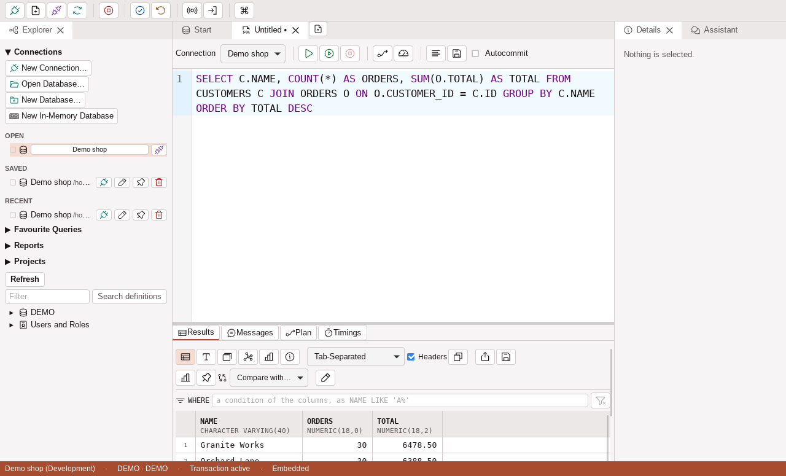
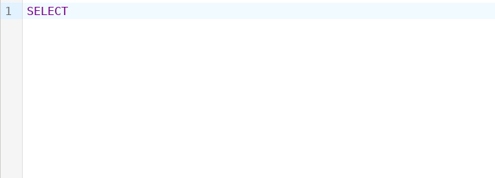
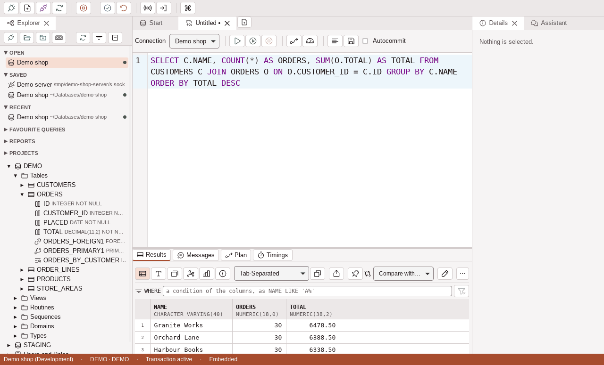
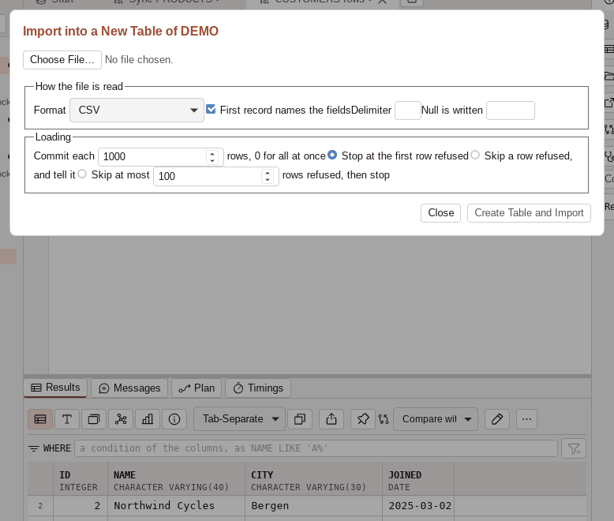

<p align="center">
    <picture>
      <source media="(prefers-color-scheme: dark)" srcset="artwork/studio-logo-white.svg">
      
    </picture>
</p>

> Turborel Studio is in alpha, meaning, version 0.0.0. Its version is
> the number of the Turborel release it is made for, and the alpha is
> made for Turborel 0.0.0. Anything may change from one build to the
> next, its files and behaviour alike. See [VERSIONING.md](VERSIONING.md).
> The latest Turborel alpha is built for Linux, macOS and Windows as the
> pre-release
> [nightly](https://github.com/turborel/turborel/releases/tag/nightly),
> and as the image `ghcr.io/turborel/turborel:nightly`.

Turborel Studio is the desktop database IDE for
[Turborel](https://github.com/turborel/turborel), a relational database
system. It opens both of Turborel's modes: a Turborel server,
`turboreld`, through Turborel's own client library, turborel-client;
and an embedded database, in a folder or in memory, opened in Studio's
own process through the `turborel` crate's embedded library. It gives a
person who works with the database one window for it:

- [server connections, and embedded databases](doc/user/03-connections.md)
  opened, made new, or made in memory as a scratch database that is
  never saved;
- a [Connections and Object Explorer](doc/user/04-explorer.md) tree of
  the catalog;
- tabbed [SQL worksheets](doc/user/05-worksheets.md), each with its
  results and messages, completion, and a plan viewer that shows what a
  data change would do without running it;
- [Run SQL File](doc/user/07-editing-data.md#running-a-sql-file), which
  runs a `.sql` file of any size without the editor, summed up and
  judged by the guards first, with progress, cancel and an error log;
- a [results grid](doc/user/06-results.md) that reads a query's rows a
  page at a time, and shows, edits, copies and sums exact numbers of
  every one of their 38 digits;
- [editing a table's rows](doc/user/07-editing-data.md), importing
  them from CSV, JSON or Excel into a table or a new one typed from the
  file, each format a plug-in its file is found by, exporting them, dialogs that write DDL, and a schema's script
  with its data, as INSERTs or CSV files;
- [schema diagrams and models](doc/user/08-modeling.md), designed
  offline or imported of a DDL script, and compared with a live schema,
  and schema compare;
- an [analyzer](doc/user/09-analyzer.md) of indexes, plans,
  statements and the planner's statistics, and reports;
- a [routine debugger](doc/user/13-debugging.md) of procedures,
  functions and triggers, with breakpoints, steps, the call stack and
  its values, on a server and an embedded database;
- an [assistant](doc/user/10-assistant.md), off until the user turns it
  on;
- [live sessions](doc/user/11-live-sessions.md), a workspace shared with
  others as it is worked in, joined by an invitation's code or a link,
  and recorded on the presenter's machine if asked, replayed and
  summed up for a ticket;
- a [monitor](doc/user/12-administration.md) of the server or the
  database: its sessions, what each runs and waits on, the statements
  run and the tables' and indexes' sizes and use, its settings, plug-ins,
  users and replication;
- every command on the keyboard, in Studio's own keys or the function
  keys' scheme, any key rebound ([Appendix A](doc/appendix/a-keyboard.md)).

<p align="center">
    <picture>
      <source media="(prefers-color-scheme: dark)" srcset="doc/images/window-dark.png">
      
    </picture>
</p>

<p align="center">
    <picture>
      <source media="(prefers-color-scheme: dark)" srcset="doc/images/completion-dark.gif">
      
    </picture>
    <picture>
      <source media="(prefers-color-scheme: dark)" srcset="doc/images/plan-dark.gif">
      
    </picture>
    <picture>
      <source media="(prefers-color-scheme: dark)" srcset="doc/images/import-dark.gif">
      
    </picture>
</p>

It runs on Linux, macOS and Windows, built with Tauri: a Rust backend
over turborel-client and the `turborel` crate, and a front end in
TypeScript and React. Passwords
and keys stay in the operating system's keychain, and the webview never
sees them ([SECURITY.md](SECURITY.md)).

Studio is built in milestones, M0 to M12. [CONFORMANCE.md](CONFORMANCE.md)
says what it supports of Turborel, row by row, and [TODO.md](TODO.md)
what is open.

## Download

The latest alpha of Studio is built after each change of main that
passed every check, as the pre-release
[nightly](https://github.com/turborel/studio/releases/tag/nightly):

| System | Installer |
|---|---|
| macOS on Apple silicon | [turborel-studio-nightly-macos-arm64.dmg](https://github.com/turborel/studio/releases/download/nightly/turborel-studio-nightly-macos-arm64.dmg) |
| Windows on x64 | [turborel-studio-nightly-windows-x64.msi](https://github.com/turborel/studio/releases/download/nightly/turborel-studio-nightly-windows-x64.msi) |
| Linux on x64, any distribution | [turborel-studio-nightly-linux-x64.AppImage](https://github.com/turborel/studio/releases/download/nightly/turborel-studio-nightly-linux-x64.AppImage) |
| Debian and Ubuntu on x64 | [turborel-studio-nightly-linux-x64.deb](https://github.com/turborel/studio/releases/download/nightly/turborel-studio-nightly-linux-x64.deb) |

The nightly signs the macOS and Windows installers once the project's
signing certificates are set, and its notes say how each is signed; an
unsigned one makes macOS and Windows ask before opening it the first
time. [Installing](doc/user/01-installing.md#the-nightly) says how to
open each, and how to check it against the release's `SHA256SUMS`.

## Requirements

- Linux, macOS or Windows, with the platform's webview: WebKitGTK 4.1 on
  Linux, WKWebView on macOS, WebView2 on Windows
  ([RULES.md](RULES.md) D3).
- For server connections, a Turborel server of the same release
  ([running the server](https://github.com/turborel/turborel/blob/main/doc/operator/02-turboreld.md)).
  An embedded or in-memory database needs no server: Studio holds
  Turborel's engine itself, at the commit it is pinned to
  ([Versions](doc/appendix/c-versions.md)). A database another alpha
  build of Turborel made may not open with it, and Studio says so.

## Building

No build is published yet. Studio's installers are published only with
a release of Turborel's ([VERSIONING.md](VERSIONING.md)).
Until then, build it from source, as
[Installing](doc/user/01-installing.md) says: Rust (the toolchain
`rust-toolchain.toml` names), Node.js 24 or later, and the platform's
webview and its build dependencies.

```
npm ci
npm exec -- tauri build
```

## The manual

[doc/](doc/README.md) is the manual: a User's Guide and Appendices,
published at https://turborel.com/docs/studio/. Each chapter is written
as the milestone that fills it lands. The SQL Studio runs, and the
server, are described in Turborel's own manual,
[Turborel Documentation](https://github.com/turborel/turborel/blob/main/doc/README.md).

## Contributing

Read [CONTRIBUTING.md](CONTRIBUTING.md) before making a change: how a
change is made, its commit message, pull requests and issues. Every
change passes `cargo xtask verify`. [RULES.md](RULES.md) says how Studio
is designed, written and verified, [CONFORMANCE.md](CONFORMANCE.md) what
it supports of Turborel, and [TODO.md](TODO.md) lists open work.

## Security

Report a vulnerability privately, never in a public issue, as
[SECURITY.md](SECURITY.md) says.

## License and trademark

The code is under the BSD-2-Clause Plus Patent License, in
[LICENSE](LICENSE). The name Turborel and its logos, Studio's icon among
them, are not: [TRADEMARK.md](TRADEMARK.md) says how they may be used.
