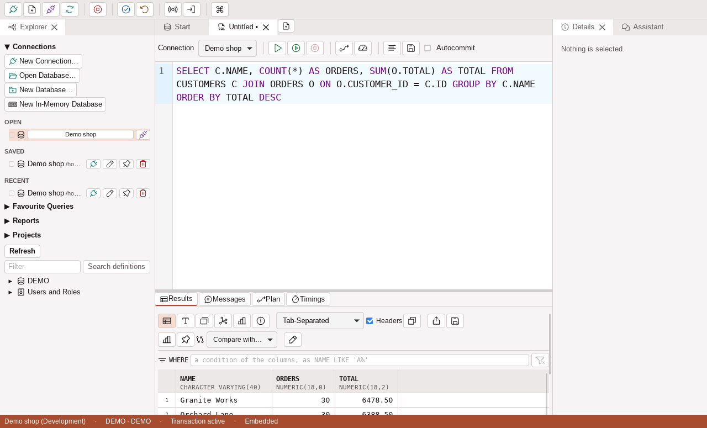
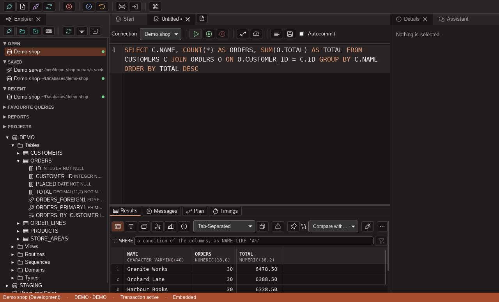
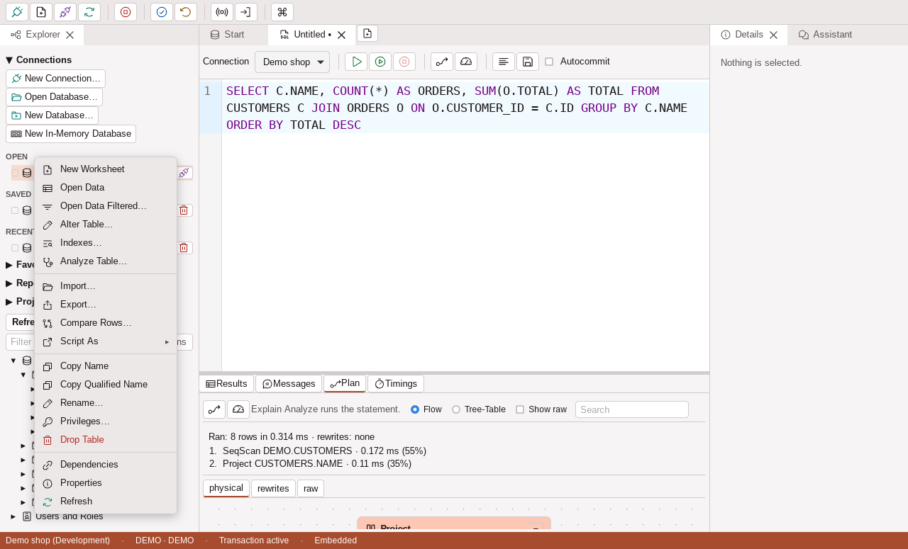
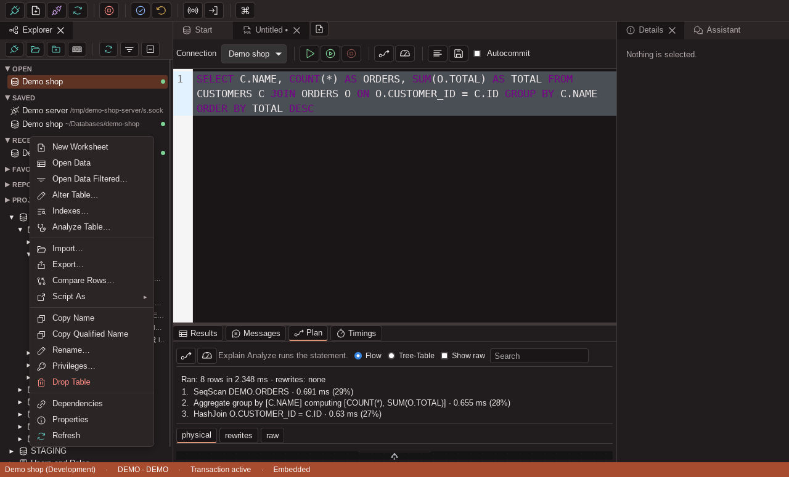

# The Window

[Contents](README.md)

Turborel Studio works in one window. Across its top are the menu bar and
the toolbar; in its middle, the dock of panels; along its foot, the
status bar.

## The menu bar

The menu bar is the platform's own: at the top of the screen on macOS,
and at the top of the window on Linux and Windows. Its menus are:

| Menu | Items |
|---|---|
| **File** | New Connection…, Open Database…, New Database…, New In-Memory Database, New Worksheet, Open File…, Run SQL File…, New Model, Open Model…, Import DDL into Model…, Save, Save As…, Reopen Closed Worksheet, History…, Settings…, Close Window |
| **Edit** | Undo, Redo, Cut, Copy, Paste, Select All |
| **Worksheet** | Run Statement, Run Script, Run Script on a Folder's Connections…, Explain, Explain Analyze, Run to CSV File…, Run to Native Rows File…, Query Builder…, Format, Toggle Comment, Upper Case, Lower Case, Find and Replace…, Toggle Bookmark, Next Bookmark, Previous Bookmark, Go to Definition, Describe, Split Editor, Outline, Add to Favourite Queries…, Autocommit, Pin Tab, Close Worksheet, Close Other Worksheets |
| **Connection** | Disconnect, Reconnect, Cancel Statement, Refresh Catalog, Monitor, Analyze Schema…, Commit, Rollback |
| **View** | Command Palette…, Theme: System, Theme: Light, Theme: Dark, Zoom In, Zoom Out, Actual Size, Assistant, Assistant Settings…, Reset Layout |
| **Live** | Present, Join…, Share Worksheet in Live Session, End Session, Leave Session, Live Session, Session Records…, Live Sessions Settings… |
| **Window** | Minimize, Full Screen |
| **Help** | About Turborel Studio, Keyboard Shortcuts |

On macOS the first menu, **Turborel Studio**, holds About, Hide and
Quit. The items of **Connection** act on the active connection, and do
nothing while none is open; those of **Worksheet**, and Save, act on the
active worksheet ([Worksheets](05-worksheets.md)).

The menus show no keys. Each item is one of Studio's commands, and each
command's key, which may be changed, is shown by the command palette and
by **Help > Keyboard Shortcuts**.

## The toolbar

The toolbar holds the commands used most, each a button of its icon, in
groups apart by a line: New Connection, New Worksheet, Disconnect and
Reconnect; Cancel Statement; Commit and Rollback; Present and Join
([Live Sessions](11-live-sessions.md)); and Command Palette. A button's tooltip
names it and its key, where it has one. A button that cannot act now, as
Disconnect with no connection open, is disabled. The setting **Show the
toolbar's labels beside its icons** adds each button's name.

Studio's icons are of one set. The actions people look for have colours
of their own, in both themes: running green, stopping and cancelling
red, committing blue and rolling back amber, connecting teal and
disconnecting purple. The command palette, **Help > Keyboard
Shortcuts**, the explorer's tree, the details panel and the dock's tabs
show the same icons. The platform's menu bar shows none, as the
platforms' own menus seldom do.

## The dock

The dock holds the panels. When Studio is first opened:

- the **Explorer** is on the left, with the connections, open and saved
  ([Connections](03-connections.md)), and the catalog of the active
  connection ([The Object Explorer](04-explorer.md));
- the centre is the **Start** panel, whose **New Connection…** and
  **New Worksheet** begin, and each worksheet opens there as a tab of
  its own, marked by the colour of the connection it runs on; the **+**
  after a group's tabs opens a new worksheet there;
- **Details** is on the right, showing what is selected in the explorer,
  and the **Assistant** a tab beside it ([The Assistant](10-assistant.md)).

A panel is moved by dragging its tab: onto another group to join it, or
to a group's edge to split it. A group is resized by dragging the line
between it and the next. Studio keeps the layout as it is left, and lays
the window out so when it opens again. **View > Reset Layout** lays it
out as it was first. **View > Assistant** shows the assistant's panel,
added beside Details where the layout has it not.

## Context menus

The secondary button, or Shift+F10 or the context menu key, opens the
menu of what is under the pointer, or has the focus: its items, each
with its icon and its key, are those its menus, buttons and the command
palette offer of it. The arrow keys move through a menu, Right opens a
submenu and Left closes it, Enter or Space chooses an item, and Escape
closes the menu, the focus given back. An item that destroys is drawn in
the colour of danger, and its statement runs in a worksheet of its own,
through the connection's guards, as one typed would
([Connections](03-connections.md#environments-and-guards)).

| Of | Its menu |
|---|---|
| an open connection in the explorer | New Worksheet, on it; Refresh Catalog; Analyze Schema…; Edit Connection…; Copy URI, with no password; Reconnect; Disconnect |
| a saved connection | Connect; Edit Connection…; Copy URI; Pin or Unpin; Delete…, which asks for its name typed |
| a schema | New Worksheet, its schema set; Create Table…; Import into New Table…; Generate Script…; Open Model; Compare Schema…; Analyze Schema…; Copy Name; Properties; Refresh |
| a table | New Worksheet; Open Data, its first 200 rows; Open Data Filtered…; Alter Table…; Indexes…; Analyze Table…; Import…; Export…; Compare Rows…; Script As CREATE, ALTER, DROP, SELECT, INSERT, UPDATE or DELETE, to a worksheet or the clipboard; Copy Name; Copy Qualified Name; Rename…; Drop Table; Dependencies; Properties; Refresh |
| a view | New Worksheet; Open Data; Script As CREATE, SELECT or DROP; Copy Name; Copy Qualified Name; Drop View; Dependencies; Properties; Refresh |
| a column, a constraint, an index or a trigger | Copy Name; Rename Column… and Drop Column, of a column; Drop Constraint, Drop Index or Drop Trigger; Properties |
| a routine, a sequence, a domain or a type | Execute…, of a routine; Script As CREATE; Copy Name; Copy Qualified Name; its Drop; Properties |
| a result's cell | Copy; Copy with Headers; Copy As each format; Filter to This Value; Filter Out This Value; Sort Ascending; Sort Descending; Hide Column; Show Hidden Columns; Freeze Up to This Column; Unfreeze Columns; View Value; Show in Record View; Edit Rows; Set to NULL; Export Selection… |
| a result's header | Sort Ascending; Sort Descending; the column hidden, shown or frozen; Copy, of the column |
| the editor | Run Statement; Run Script; Explain; Explain Analyze; Format; Toggle Comment; Upper Case; Lower Case; Go to Definition; Describe; Find and Replace…; Add to Favourite Queries… |
| a worksheet's tab | Close; Close Others; Close to the Right; Pin Tab or Unpin Tab; Rename…; Duplicate; Reveal Connection |
| a model's table | Edit Table…; Add Referenced Tables; Hide from Diagram; Script As CREATE, to a worksheet or the clipboard; Remove from Model |
| a model's diagram | Add Table…; Lay Out Again; Show Hidden Tables |

New Worksheet of a schema, or of a table, runs `SET SCHEMA` of its
schema first in the new worksheet, where the session's is another; the
session is the connection's, so every worksheet on it then runs in that
schema. A routine's Execute… opens a worksheet that calls it, `CALL` of
a procedure and `VALUES` of a function, each argument a `?` whose value
the worksheet asks for as it runs. Close Others and Close to the Right
leave pinned tabs open. Elsewhere the webview's own menu is offered in a
field of text alone, where it cuts and pastes.

## The status bar

With no connection open, the status bar says **Not connected**. With
one, it shows the active connection:

- its name, and its environment: Development, Test or Production;
- the session's user and, after a dot, its default schema, as the server
  tells them;
- its transaction: **No transaction**, **Transaction active**, or
  **Autocommit** where each statement is its own transaction, with
  ", read only" where the transaction is READ ONLY;
- **Read-only connection** for a connection set read-only;
- **Replica** where the server takes no changes;
- the server's time for the last statement, in milliseconds;
- how the connection reaches the server: **TLS**, **Local socket**, or
  **NOT SECURE**, shown white on red, for one over plain TCP; or, of an
  embedded database, **Embedded**, or **In-memory, not saved**;
- **Connection lost: reconnect to go on**, once the server is lost.

A connection of an environment, or given a colour of its own, tints the
window: its frame and the status bar take the colour, production's red
by default ([Environments](03-connections.md#environments-and-guards)).

## The command palette

**View > Command Palette…**, or its key, Cmd+Shift+P on macOS and
Ctrl+Shift+P elsewhere, lists every command that can run now, by its
menu and title, with its key. Typing filters them: a command is listed
if its name holds every word typed, in any case. The arrow keys choose
one, Enter runs it, and Escape closes the palette.

## Themes and zoom

Studio has a light theme and a dark one. By default it follows the
system's; **View > Theme** chooses one for good. The accent of both is
the copper of Studio's icon, its ribbon spiral, in a step of it that
reads on each theme's background.

**View > Zoom In** and **Zoom Out** change the window's zoom by ten
percent at a time, from 50 % to 300 %; **Actual Size** sets it back to
100 %.

## Settings

**File > Settings…** sets:

- the theme;
- the zoom, in percent;
- the editor's font and its size, in points, from 8 to 48;
- whether the toolbar shows its buttons' labels beside their icons;
- whether what runs is kept in the history; the formatter's case of key
  words, its indentation and its width of lines; and how long a run
  lasts before its end, in the background, is notified;
- whether open connections are checked as the computer wakes, and those
  lost connected again;
- each command's key, under **Keys**.

Each change is saved at once. [Appendix B](../appendix/b-settings.md)
describes each setting, and the file it is kept in.

## Keys

A key is written as Studio shows it: Cmd, on macOS, or Ctrl, then Alt
and Shift, then the key itself, joined by `+`, as `Ctrl+Shift+P`. In
**Settings > Keys**, a command's key is typed the same way, with `Mod`
for Cmd on macOS and Ctrl elsewhere, so `Mod+Shift+P` is the same key on
every platform. A key left empty unbinds the command; one typed as the
default goes back to it. [Appendix A](../appendix/a-keyboard.md) lists
every command and its key.

Every dialog keeps the focus within it: Tab and Shift+Tab move between
its fields, and Escape closes it.

## When the window fails

Should the window fail as it is drawn, a panel takes its place, saying
what failed: **Copy Details** copies them, **Reset Layout and Reload**
lays the dock out afresh and loads the window again, and **Reload** loads
it again as it was. A failure of something running in the window is told
in the error banner under the toolbar. Either is kept in `failures.log`
([Appendix D](../appendix/d-files.md)).

A file of Studio's that does not fit, as one an earlier build wrote of
another shape, is set aside, and Studio starts without it; a notice under
the toolbar names the file, where it was kept and why, until
**Dismiss**.
