# Editing Data

[Contents](README.md)

A table's rows are edited in a worksheet's results, each change staged
until it is applied, all of them then in one transaction. A file's rows
are imported into a table, a table's rows exported to a file, and two
tables' rows compared. A table is made, or altered, by a dialog that
writes its DDL as it is filled in. A `.sql` file of any size is run on
a connection without the editor. A base table's details, in the
explorer, offer each of its tasks, and a schema's details **Create
Table…**, **Import into New Table…** and **Generate Script…**:

| Action | What it does |
|---|---|
| **Edit Rows…** | opens the table's first rows, or those a condition keeps, in a worksheet of their own, to be edited |
| **Import…** | imports the rows of a CSV, tab-separated, JSON or Excel file into the table |
| **Export…** | exports the table's rows, or those a condition keeps, to a file |
| **Compare Rows…** | compares the table's rows with another table's, and writes the statements that make the other's rows the same |
| **Alter Table…** | alters the table, an action of ALTER TABLE at a time |
| **Create Table…** | makes a table in the schema |
| **Import into New Table…** | makes a table in the schema of a file's fields, its columns typed from the file, and imports its rows |
| **Generate Script…** | writes the definitions of the schema's objects chosen, in a worksheet or a file, with their tables' rows if asked |

## Editing rows

**Edit Rows…** asks how many rows, 200 at first, and a condition of the
table's columns, and opens a worksheet of the query that reads them:

```sql
SELECT * FROM "ANN"."STAFF" WHERE ID > 1 FETCH FIRST 50 ROWS ONLY
```

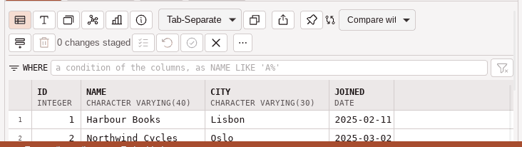

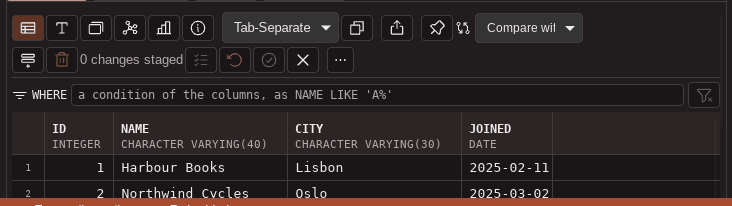

The query is run, and its rows are opened to be edited. The rows of any
result are edited too, by the result's **Edit Rows**, where its query
reads one base table, by its name or the session's schema's, and the
result holds each column of the table's key: its primary key, or else a
unique key of columns none of which takes null. Each of the result's
columns is the table's column of its name.

While the rows are edited:

- A cell is edited in place, as text, as the grid shows it: a binary
  value in hexadecimal digits ([Worksheets](05-worksheets.md#parameters-and-script-variables)).
  A cell's menu sets it to NULL (**Set to NULL**). A cell changed, and a
  row added, are drawn in the colour of a selection.
- A generated column, an identity column whose values are always
  generated, a column of no column of the table, and a large object not
  sent whole in its row are not edited.
- **Add Row** adds a row at the end, each of its columns written
  DEFAULT, taking its default, until it is given a value.
- **Remove Rows Selected** marks the rows selected removed, their text
  in the colour of danger, or, of rows marked, unmarks them; a row added
  is let go.
- The tools say how many changes are staged: each cell changed, each
  row added and each row removed.
- **Review Changes…** shows the statements the changes make, each
  value a parameter, the values after it.
- **Revert Changes** lets every change go; **Stop Editing** ends the
  editing and lets them go.

Of the table ITEMS, of the key ID, a row removed, a cell changed and a row
added make:

```sql
DELETE FROM "ANN"."ITEMS" WHERE "ID" = ?;
-- "3"
UPDATE "ANN"."ITEMS" SET "NAME" = ? WHERE "ID" = ?;
-- "Quill", "1"
INSERT INTO "ANN"."ITEMS" ("NAME") VALUES (?);
-- "Pad"
```

A row removed is deleted; a row changed is updated, of its columns
changed alone, found by its key as it was read; a row added is inserted,
of the columns given values, or by DEFAULT VALUES if none is.

**Apply Changes** runs the statements. The connection's guards judge them
together first, and ask as they ask of a script
([Connections](03-connections.md#environments-and-guards)). They run in
a transaction of their own, under autocommit too, which is committed if
each UPDATE and DELETE changed exactly one row, and rolled back if one
did not, as when the row changed since it was read, or if a statement
fails: then nothing is kept, the messages pane says why, and the changes
stay staged. If the session already has a transaction active, they run
within it, and it is left to be committed or rolled back. Once applied,
the query is run again, to show the rows as they are.

## Importing

**Import…** opens the platform's dialog to choose a file, a `.csv`,
`.tsv`, `.tab`, `.txt`, `.json`, `.ndjson`, `.jsonl` or `.xlsx` file. Its
format is found by its name and what it begins with: a `.txt` of tabs is
tab-separated, of commas CSV; a workbook is found by what it begins
with whatever its name. The dialog shows its first 20 records as it is
read:

- **Format**: **CSV**, its fields between commas and quoted as they
  need; **Tab-separated**, its fields between tabs and never quoted;
  **JSON array**, one array of objects, a record an object; **JSON, an
  object a line**; or **Excel workbook**, a record a row of a sheet.
- **Sheet**: of a workbook, the sheet read, its first at first.
- **First record names the fields**: of CSV, tab-separated text and a
  sheet, the first record is its header.
- **Delimiter**: of CSV and tab-separated text, another character
  between fields, one ASCII character, not a quote or a line break.
- **Null is written**: of CSV and tab-separated text, the text a field
  not in quotes is written as to be null; an empty field is null, if
  nothing is written here.

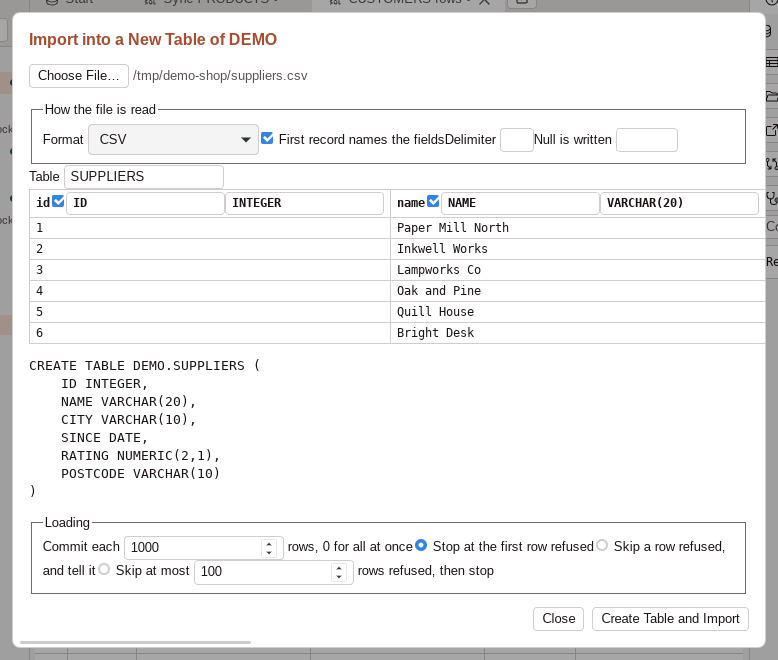

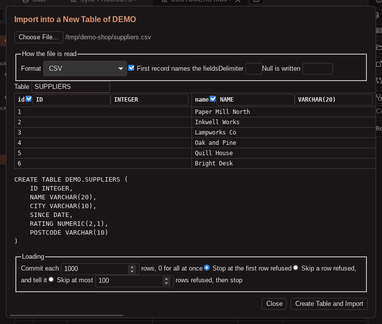

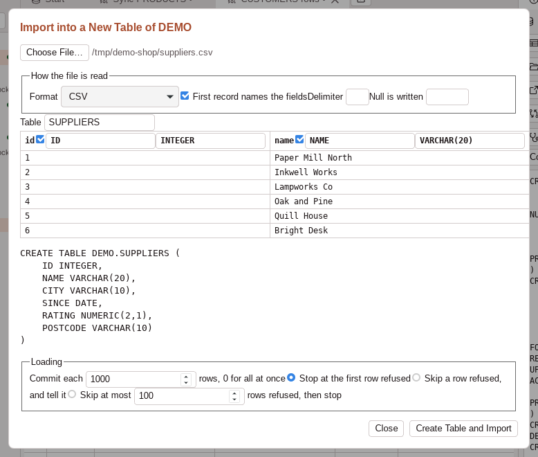

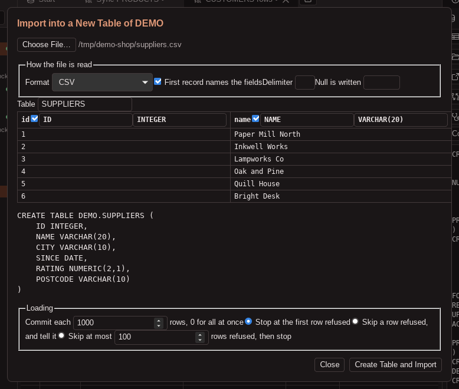

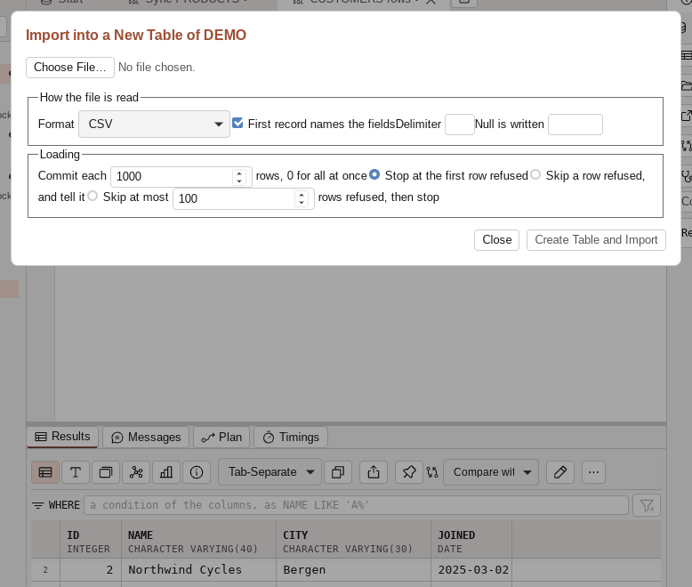

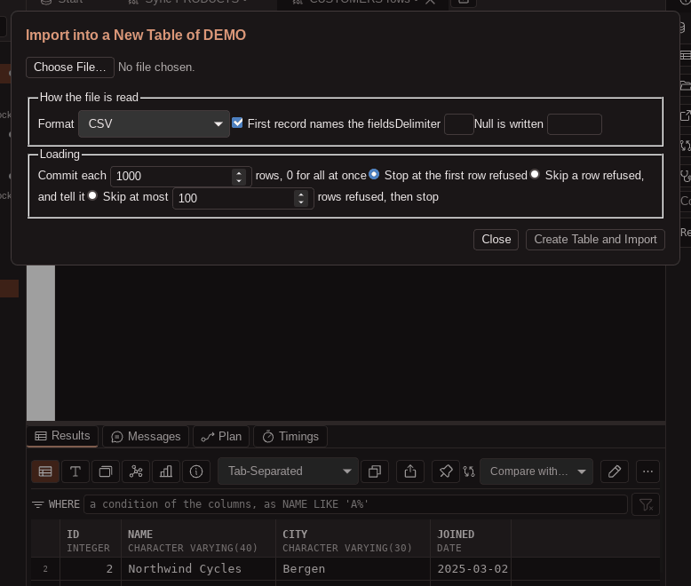

The fields of JSON are the keys of its first 100 objects, in the order
they first come; a key first seen later stops the import at its
object. A JSON number is taken exactly as written, every digit of it, so
a number of 38 digits goes whole into a NUMERIC(38) column; true and
false are TRUE and FALSE, and an object or array is its JSON text. A
cell of a sheet is taken as Excel keeps it: a number as a double, so a
number of more than 15 digits is exact only if it is written in the
sheet as text; a date as `2024-01-02`, with its time if it has one; an
error as Excel shows it, such as `#N/A`.

A field going into a binary column, BINARY, VARBINARY or BLOB, is read
in hexadecimal, as Studio writes binary values.

Above each field a choice gives the column it goes into, or **Skip**. A
field goes at first into the column its heading names, as a name is
read in SQL, a regular identifier in upper case, or else into the
column of its name in any case; of a file of no header, into the column
of its place. Under the choice, the cast its values take, of the type
Studio finds of them to the column's, `INTEGER cast to NUMERIC(38,0)`,
and in red what may go wrong: values that do not cast to the column's
type, numbers of more digits than it holds, text longer than it holds,
or nulls of a column that takes none. A column chosen for two fields,
or a column that takes no null and has no default left with no field,
is listed above the buttons.

**Import into New Table…**, of a schema, takes the same file and makes
a table of it: its name, at first the file's, and a column of each
field, named by its heading and of the type its first 1000 records
show, which may be changed, or the column left out. The types are
Turborel's: BOOLEAN; INTEGER, BIGINT, or NUMERIC of the digits seen, as
many as 38; DOUBLE PRECISION; DATE, TIME, TIMESTAMP and TIMESTAMP WITH
TIME ZONE; JSON; else VARCHAR of the longest value, rounded up. A
number written with leading zeros, as a postal code is, stays text. The
CREATE TABLE is shown as the columns change:

```
CREATE TABLE ANN.PEOPLE (
    AMOUNT NUMERIC(38,0),
    BORN TIMESTAMP
)
```

**Create Table and Import** runs it through the connection's guards
first, then imports into the new table.

**Commit each … rows** commits the rows a batch at a time, 1000 at
first, or all at once for 0. A row the server refuses, or of too many
or too few fields:

- **Stop at the first row refused**: ends the import, its batch rolled
  back.
- **Skip a row refused, and tell it**: skips it and goes on.
- **Skip at most … rows refused, then stop**: skips that many, and
  stops at the next.

**Import** asks the connection's guards first, as of an INSERT into the
table, then imports the rows by copy, where the server grants it and no
column is a large object, or by INSERT. While it runs, the dialog shows
the records read and skipped; **Cancel Import** stops it between
records, keeping the batches committed and rolling back the one under
way. At the end it says how many rows were imported, and which were
skipped and why, the first 100 of them. A file is read a record at a
time, so a file of any size is imported. An import begins with no
transaction active, as it commits its batches; one that stops says
where, why, and how many rows were committed and rolled back.

Studio reads only the file chosen in the dialog.

## Running a SQL file

**File > Run SQL File…**, or **Run SQL File…** in an open connection's
menu in the explorer, runs a `.sql` file on the connection, a server's
or an embedded database's, without opening it in the editor, so a file
of any size runs. **Choose File…** opens the platform's dialog, and
Studio reads the file through once before it runs anything, to say what
it holds:

```
3 statements in 2,048 bytes, UTF-8.
Changes rows: 2 statements
Changes definitions: 1 statement
Destroys: 1 statement
Line 7: DELETE of every row of T, with no WHERE
```

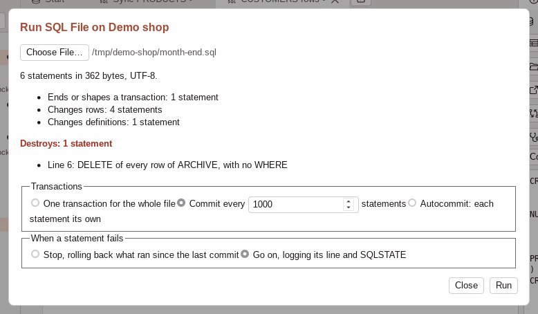

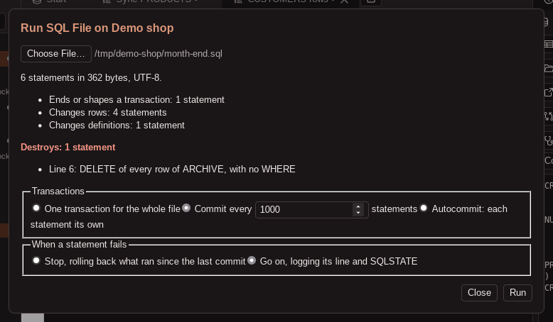

Its statements are split as a worksheet's script is, each by the line
its code begins on, counted by what they do, and each statement that
destroys listed, the first 200, the rest counted. A file of UTF-8, or of
UTF-16 with a byte order mark, is read; one of another encoding is
refused, saying so. A statement longer than 16 MiB is refused by its
line.

The choices of how it runs:

- **One transaction for the whole file**, committed at its end; **Commit
  every … statements**, 1000 at first; or **Autocommit**, each statement
  its own.
- **Stop**, at the first statement that fails, rolling back what ran
  since the last commit; or **Go on**, logging the statement that fails
  by its line and SQLSTATE. A statement that fails is undone alone, so
  the rest of its transaction stands; a failure that rolls the
  transaction back, of SQLSTATE class 40, stops a run that is not
  autocommit all the same.

**Run** asks the connection's guards of the whole file at once, as of a
script ([Worksheets](05-worksheets.md#running-statements)): a read-only
connection refuses a file that may write, naming its line; a production
connection asks before a file that may write; a statement that destroys,
or one Studio cannot classify, asks first on any connection. A file runs
only when no transaction of the session is open, and leaves autocommit
as it was. The assistant never runs a file.

While it runs, the dialog shows the statements run, the bytes read of
the file's, and the failures; **Cancel Run** cancels the statement
running and runs none after it, rolling back what ran since the last
commit. At the end it says how the run ended, the statements run, the
rows affected, the failures and the time, and lists each failure kept,
the first 10,000:

```
Finished: 3 statements run, 5 rows affected, 1 failed, in 1.5 s.
Line 4: 23000 (-201): duplicate key
```

**Save Log…** saves that log as text where the platform's dialog
chooses, beside the file at first. A query's rows are not shown: run it
in a worksheet to see them.

## Exporting

**Export…** exports the table's rows, or those a condition keeps, as
CSV or as native rows, to the file the platform's dialog chooses, as a
result's export does ([Results](06-results.md#exporting)).

## Comparing rows

**Compare Rows…** compares the table's rows, the source's, with those of
a target: a table of any open connection, its schema and its name the
source's at first. Rows are matched by the target's key, its primary key
or a unique key of NOT NULL columns, which the source must have too, and
compared by the columns both tables have, as the target types them; a
large object is not compared. Each table is read whole, in its key's
order, a page at a time, at most 100,000 rows of each, and values are
compared as their text.

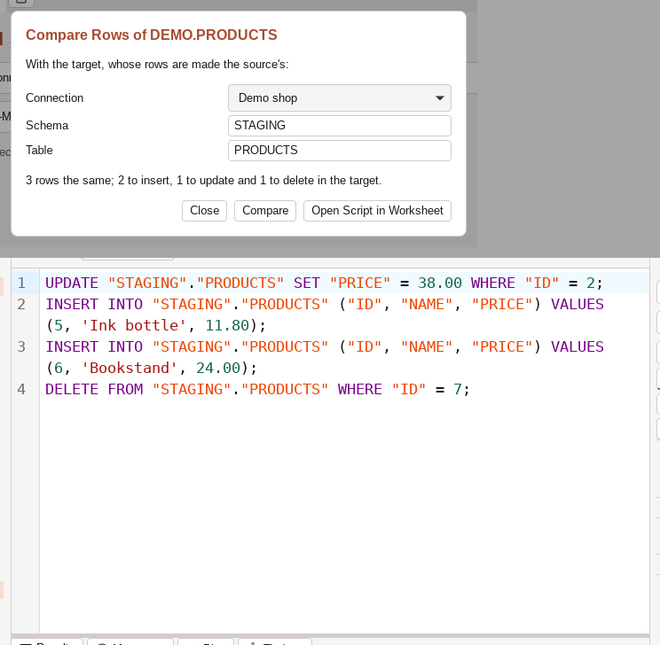

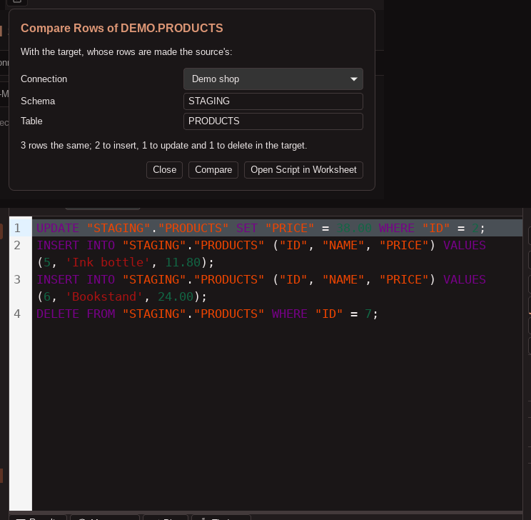

**Compare** says how many rows are the same, and how many the target
must have inserted, updated and deleted to be the same as the source.
**Open Script in Worksheet** opens the statements that make it so, in a
worksheet of the target's connection, to be read and run there: an
UPDATE of the columns that differ of each row of both, an INSERT of each
row the target lacks, and a DELETE of each row the source lacks, each
value a literal of its column's type ([Results](06-results.md#copying)):

```sql
UPDATE "ANN"."PRICES_COPY" SET "NAME" = 'Ink''s', "PRICE" = 3.00 WHERE "ID" = 2;
INSERT INTO "ANN"."PRICES_COPY" ("ID", "NAME", "PRICE") VALUES (4, 'Pad', NULL);
DELETE FROM "ANN"."PRICES_COPY" WHERE "ID" = 3;
```

## Making and altering tables

**Create Table…** makes a table in the schema. Its form gives the
table's name; its columns, each with its name, its type, chosen from
Turborel's types or written, whether it is NOT NULL, its default, as SQL
writes it, and whether it is the primary key or unique; and the table's
constraints, each a primary key, unique, a check or a foreign key, of a
name or none. A column is moved up, removed or added; a constraint
removed or added. As it is filled in, the dialog shows the CREATE TABLE
it writes ([CREATE TABLE](https://github.com/turborel/turborel/blob/main/doc/sql/statements/create-table.md)),
each name as Turborel reads it back, bare where it is a regular
identifier in upper case and not reserved, else in quotes; each type,
default and condition as written:

```sql
CREATE TABLE ANN.DEPT (
    ID INTEGER NOT NULL PRIMARY KEY,
    NAME VARCHAR(20) DEFAULT 'none' UNIQUE
);
```

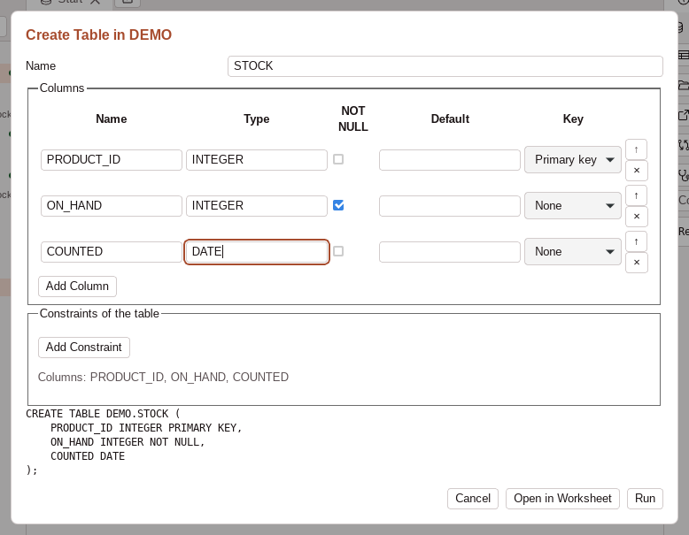

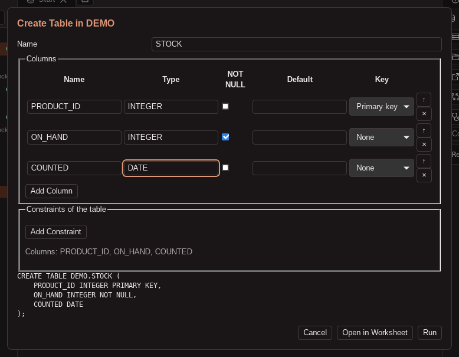

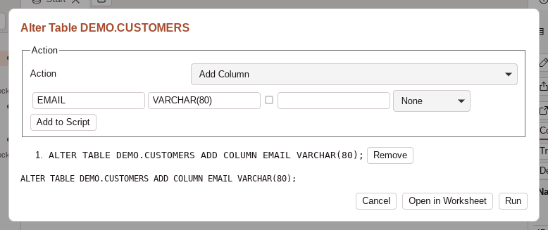

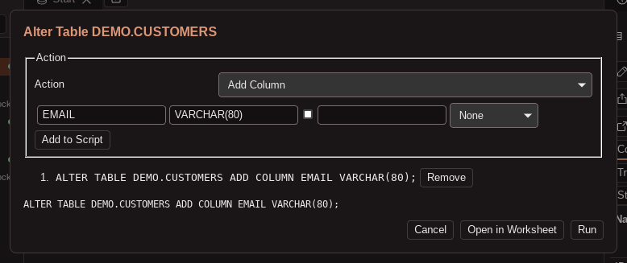

**Alter Table…** alters the table, ALTER TABLE taking one action a
statement ([ALTER TABLE](https://github.com/turborel/turborel/blob/main/doc/sql/statements/alter-table.md)).
An action is chosen, its fields filled in, and **Add to Script** adds its
statement to the script; an action added is removed by its **Remove**:

| Action | What it writes |
|---|---|
| **Add Column** | `ADD COLUMN` of the column defined |
| **Drop Column** | `DROP COLUMN` of the column chosen, RESTRICT or CASCADE |
| **Rename Column** | `RENAME COLUMN … TO` its new name |
| **Set Default**, **Drop Default** | `ALTER COLUMN … SET DEFAULT` or `DROP DEFAULT` |
| **Set NOT NULL**, **Drop NOT NULL** | `ALTER COLUMN … SET NOT NULL` or `DROP NOT NULL` |
| **Set Data Type** | `ALTER COLUMN … SET DATA TYPE`, a longer or more precise type of its kind |
| **Add Constraint** | `ADD` of the constraint defined |
| **Drop Constraint** | `DROP CONSTRAINT` of the constraint chosen, RESTRICT or CASCADE |
| **Rename Table** | `RENAME TO` its new name |

```sql
ALTER TABLE ANN.STAFF2 ADD COLUMN NOTE VARCHAR(10) DEFAULT 'x' NOT NULL;
ALTER TABLE ANN.STAFF2 ALTER COLUMN NOTE SET DATA TYPE VARCHAR(40);
ALTER TABLE ANN.STAFF2 RENAME COLUMN NOTE TO REMARK;
```

Either dialog's **Open in Worksheet** opens its DDL in a worksheet of the
connection, to be read, changed and run there; **Run** opens it and runs
it at once. It runs as any script does, through the connection's guards,
in the session's transaction, and the explorer reads the catalog again
after it.

## Generating a script

**Generate Script…** lists the schema's objects, each chosen at first:
its user-defined types, domains, sequence generators, base tables,
views and routines, in that order. **Choose None** and **Choose All**
choose them together. **Open in Worksheet** opens, in a worksheet of
the connection, the definition of each object chosen, as the explorer's
**Definition** writes it ([The Object Explorer](04-explorer.md#the-definition)),
in that order, a blank line between each.

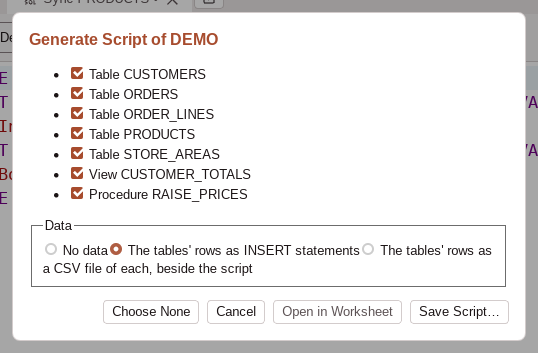

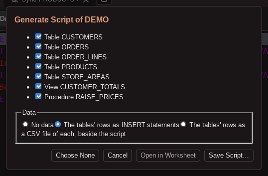

**Save Script…** saves the same script where the platform's dialog
chooses, and **Data** says what it carries of the base tables chosen:

- **No data**: their definitions alone.
- **The tables' rows as INSERT statements**: after the definitions, an
  INSERT of each row, the tables in the order their foreign keys need,
  each value written as Turborel writes its literal, so a number keeps
  every one of its digits. A generated column is left out, as INSERT
  takes none, and an identity column GENERATED ALWAYS takes its value
  by OVERRIDING SYSTEM VALUE. **Run SQL File…** loads the script back,
  definitions and rows:

  ```
  -- The rows of "ANN"."STAFF".
  INSERT INTO "ANN"."STAFF" ("ID", "NAME") OVERRIDING SYSTEM VALUE VALUES (1, 'O''Neil');
  ```

- **The tables' rows as a CSV file of each, beside the script**: a file
  of a header and the rows of each table, named of the script, the
  schema and the table, as `ANN.ANN.STAFF.csv` of a script `ANN.sql`.
  **Import…** of the table, or `turborel --import`, loads each back by
  copy; an identity column GENERATED ALWAYS takes its values so only
  once it is made GENERATED BY DEFAULT, or its field skipped.

A large object is read whole, by its locator if the server sends it so,
and written as a string, or, past 16,000 characters or octets, strings
joined by `||`; one of more than 8 MiB is written only to a CSV file,
the INSERTs stopping with why. In a CSV file a binary value is written
in hexadecimal, which **Import…** reads back into a binary column. After
the rows, the script restarts each identity column past them, at the
greatest value plus its increment, so a row added after takes a value of
its own:

```
-- Each identity column restarted past its rows.
ALTER TABLE "ANN"."STAFF" ALTER COLUMN "ID" RESTART WITH 3;
```
