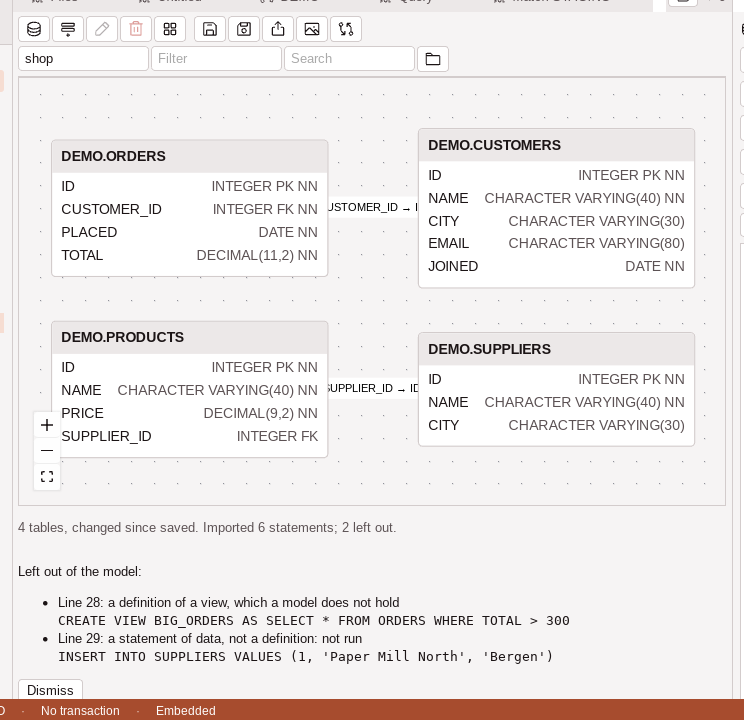
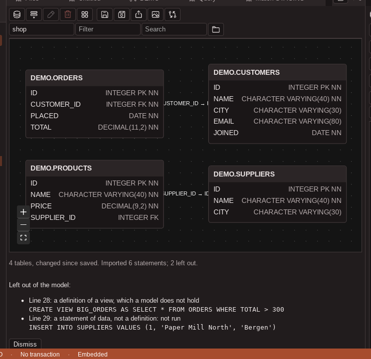
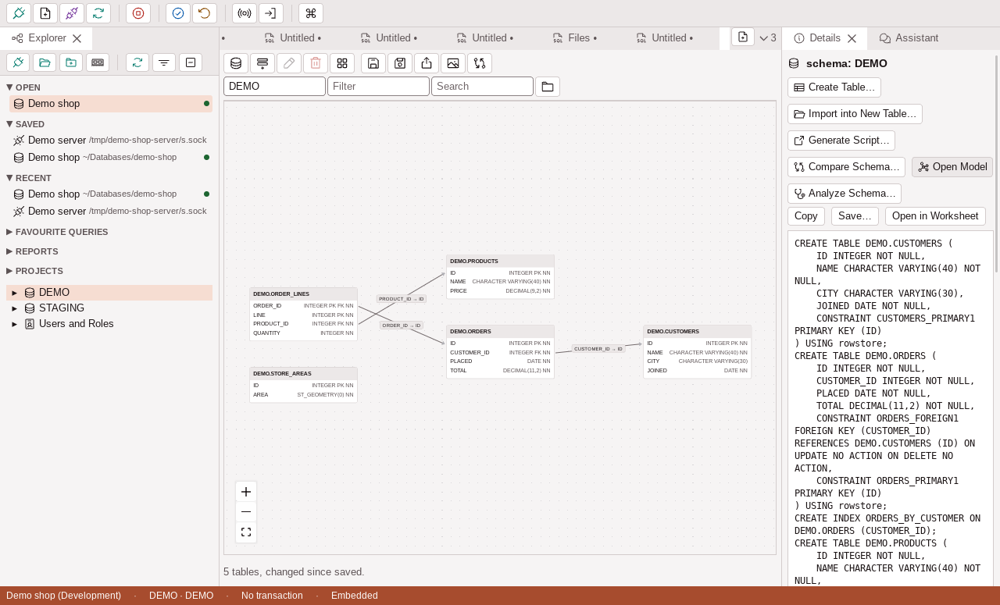
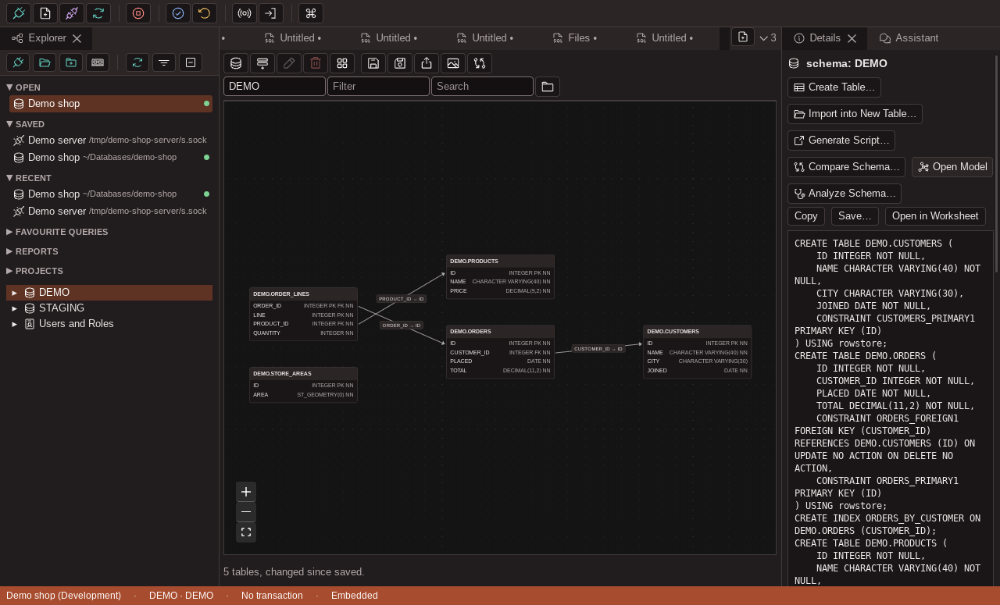
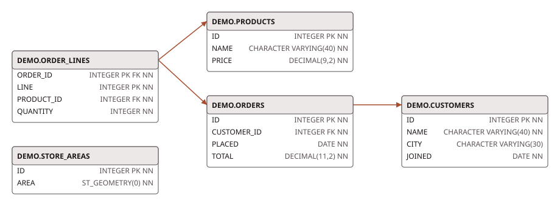
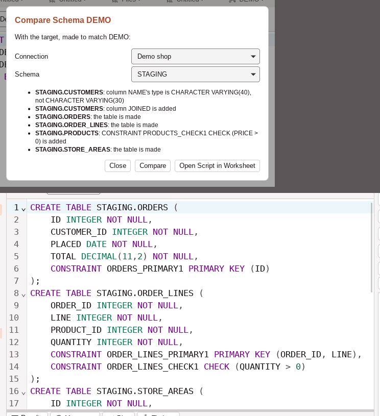
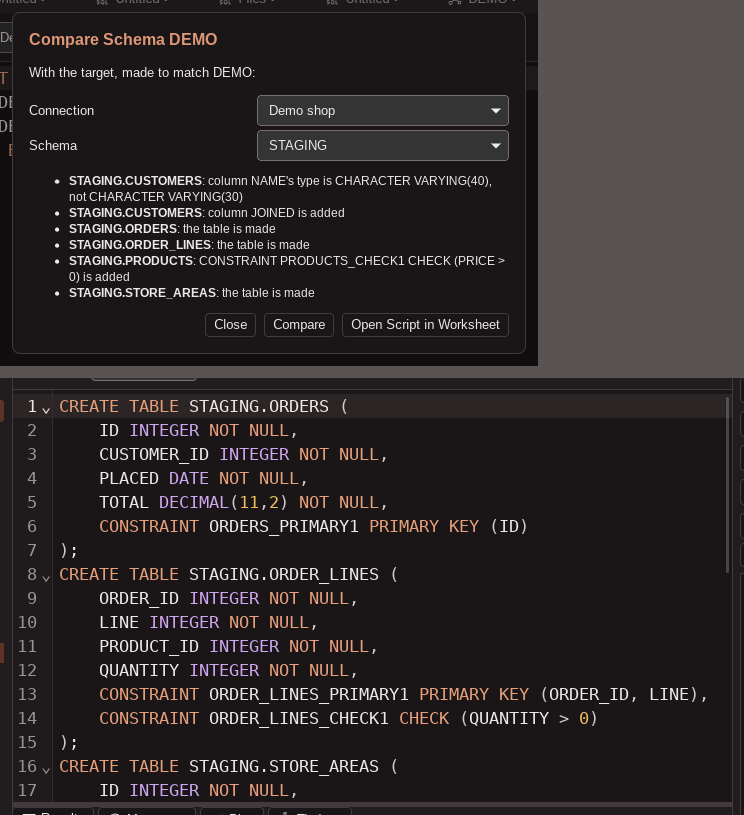
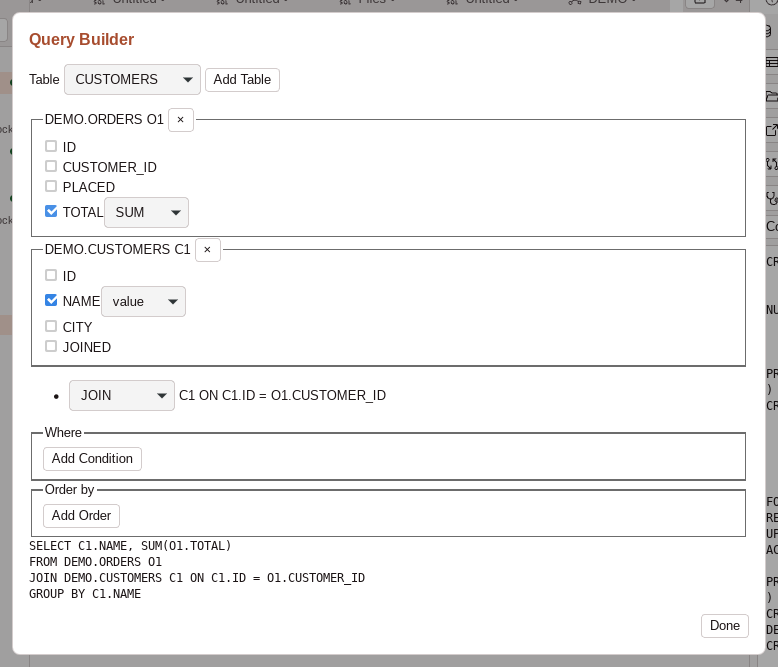
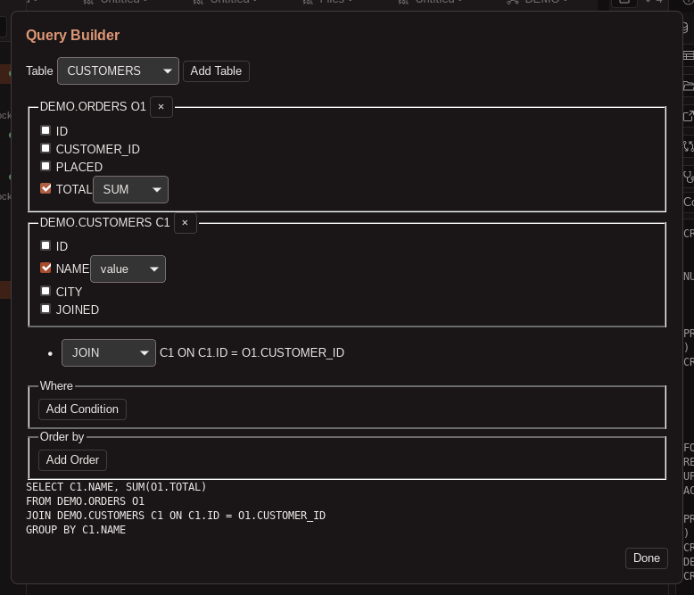

# Schema Modeling

[Contents](README.md)

A model is a schema's tables drawn as a diagram: each table a box of its
columns, each foreign key a line from its table to the one it
references. A model is read from a live schema, imported of a DDL
script, or designed table by table, and kept as a file of its own. It is compared with a live schema,
and the script that takes the schema to the model is written, to be read
and run in a worksheet; two live schemas are compared the same way. The
query builder writes a query of a schema's tables, their joins following
from their foreign keys.

## Models

**File > New Model** opens an empty model in a tab of its own; **File >
Open Model…** opens a model's file the platform's dialog chooses. A
schema's details, in the explorer, offer **Open Model**, which opens a
model of each of the schema's base tables, read whole, and its property
graphs.

The tab's toolbar:

| Tool | What it does |
|---|---|
| **Read Tables of a Schema…** | reads the tables chosen of a schema of an open connection into the model, each in place of a table of its name, and the schema's property graphs |
| **Add Table…** | designs a new table of the model |
| **Edit Table…** | designs the table selected |
| **Remove Table** | removes the table selected from the model |
| **Lay Out Again** | lays every table out afresh |
| **Save Model**, **Save Model As…** | saves the model to its file, or to one the platform's dialog chooses |
| **Export as SVG…**, **Export as PNG…** | saves the diagram as an image |
| **Compare with a Schema…** | compares the model with a live schema ([Comparing](#comparing)) |
| **Model name** | the model's name, its tab's title |
| **Filter tables** | shows the tables whose schema and name hold the text, in any case |
| **Search tables** | centres the diagram on the first table whose schema and name hold the text |
| **Group by Schema** | draws a box of each schema behind its tables |

A model's tab is marked `•` while it has changed since it was saved.
Closing it lets its changes go. A model is not kept between sessions but
in its file ([Appendix D](../appendix/d-files.md#a-models-file)).

## Importing a DDL script

**File > Import DDL into Model…** makes a model of a `.sql` file of
CREATE statements the platform's dialog chooses, so a schema kept as a
script is diagrammed, compared with a live schema, and its migration
script written as any model's is. Studio asks the schema of the names
the script does not qualify, the active connection's at first, and runs
the script's definitions in an in-memory database of its own, which
nothing else sees and which is gone once the model is read: Turborel
reads each statement as a server would, so each table, column type,
default, key, foreign key and index is the one Turborel defines. The
model holds the tables of each schema the script made, read as **Read
Tables of a Schema…** reads them.





What a model does not hold is left out of it, and listed under the
diagram by its line, with why, until **Dismiss**:

- a definition of another kind, as a view, a routine or a sequence: run,
  as a table may need it, but not modeled;
- a statement of data, as an INSERT, or of privileges or users, as a
  GRANT, or of the server: not run;
- a definition the database refuses: with its SQLSTATE and why.

```
Left out of the model:
Line 6: a definition of a view, which a model does not hold
Line 7: a statement of data, not a definition: not run
```

The note under the diagram tells how many statements the script held,
and how many were left out. Nothing is guessed of a statement that is
not run, and no statement of the script reaches a database of yours.

## The diagram

Each table is a box of its schema and name, then each column, its type,
and its marks: `PK` of its primary key, `FK` of a foreign key, `NN` of
NOT NULL. Each foreign key is a line from its table to the one it
references, labelled by its columns, the columns they reference, and its
delete rule, unless NO ACTION. Each edge table of a property graph is a
dashed line to each of its vertex tables, labelled by the graph's name
and its end, SOURCE or DESTINATION, where both tables are in the model.
The property graphs are also listed beside the diagram, each with its
element tables.







Tables are laid out from left to right along their foreign keys; a table
already placed keeps its place, and a table dragged keeps the place it is
dropped at. A table's menu, by the secondary button, or Shift+F10 on the
diagram with the table selected, edits it, adds the tables its foreign
keys reference, read of the connection the model was read from, hides it
from the diagram, scripts its CREATE TABLE, or removes it from the model;
the diagram's menu adds a table, lays the diagram out again, and shows
the tables hidden. A table hidden is still the model's, saved and
compared with it; the hiding is not saved. A click on a table selects it; a click on the diagram's
background selects none. The diagram zooms and pans by the pointer and
by its controls.

**Export as SVG…** writes the diagram as SVG: each table's box of its
name and columns, each column's type and marks, and each foreign key a
line. **Export as PNG…** draws that SVG on a canvas, twice its size, and
saves the image.

## Designing a table

**Add Table…** and **Edit Table…** open the table's form: its schema and
name; its columns, each with its name, its type, chosen from Turborel's
types or written, whether it is NOT NULL, its default, as SQL writes it,
and whether it is the primary key or unique; its constraints of the
table, each a primary key or unique of several columns, a check or a
foreign key, its name optional; and its indexes, each of its name, its
columns, written between commas, and its method, `btree` at first.
**Save Table** keeps the table in the model, in place of the one edited.

## Comparing

**Compare with a Schema…** compares the model's tables of a schema with
the base tables of that schema on an open connection, and lists what
differs. **Open Script in Worksheet** opens, in a worksheet of that
connection, the script that takes the schema to the model, never run by
the comparison:

| Of | The script |
|---|---|
| a table of the model the schema lacks | `CREATE TABLE` of its columns, keys and checks; its foreign keys added once every table is made, and `CREATE INDEX` of its indexes |
| a table of the schema the model lacks | `DROP TABLE … RESTRICT` |
| a column added, dropped, or of another type, default or NOT NULL | `ALTER TABLE` of `ADD COLUMN`, `DROP COLUMN … RESTRICT`, `SET DATA TYPE`, `SET DEFAULT` or `DROP DEFAULT`, `SET NOT NULL` or `DROP NOT NULL` |
| a constraint added or dropped | `ALTER TABLE … ADD` or `DROP CONSTRAINT … RESTRICT` |
| an index added or dropped | `CREATE INDEX`, or `DROP INDEX` |





Constraints and indexes are matched by what they are, their columns,
condition, references and rules, or columns and method, not by their
names. Types are matched by their standard names, so `VARCHAR(40)` is
`CHARACTER VARYING(40)`, and a type written with no length is the same as
one of a length. The statements run in an order that works: foreign keys
dropped first, then indexes, constraints and tables; tables made, then
columns changed; constraints added, then foreign keys, then indexes. CREATE
INDEX and DROP INDEX run outside a transaction, so the script is run
under autocommit.

Of a model whose table STAFF has ID a BIGINT, DEPT NOT NULL of the
default 1, a column NOTE in place of AGE, a check of NOTE and an index of
NOTE by hash, where the schema's STAFF has ID an INTEGER, AGE, a unique
constraint of DEPT and AGE, a check of AGE and an index of DEPT, the
script is:

```sql
DROP INDEX STAFF_BY_DEPT;
ALTER TABLE ANN.STAFF DROP CONSTRAINT STAFF_UNIQUE1 RESTRICT;
ALTER TABLE ANN.STAFF DROP CONSTRAINT STAFF_AGE RESTRICT;
ALTER TABLE ANN.STAFF ALTER COLUMN ID SET DATA TYPE BIGINT;
ALTER TABLE ANN.STAFF ALTER COLUMN DEPT SET DEFAULT 1;
ALTER TABLE ANN.STAFF ALTER COLUMN DEPT SET NOT NULL;
ALTER TABLE ANN.STAFF ADD COLUMN NOTE VARCHAR(40);
ALTER TABLE ANN.STAFF DROP COLUMN AGE RESTRICT;
ALTER TABLE ANN.STAFF ADD CONSTRAINT STAFF_NOTE CHECK (NOTE <> '');
CREATE INDEX STAFF_BY_NOTE ON ANN.STAFF (NOTE) USING hash;
```

A schema's details offer **Compare Schema…**, which compares the schema,
the source, with a target schema of any open connection: each read
whole, the source's tables taken as the target schema's, and its foreign
keys within its own schema too. It lists the differences, and **Open
Script in Worksheet** opens, in a worksheet of the target's connection,
the script that makes the target match the source.

## The query builder

**Worksheet > Query Builder…** opens a new worksheet, on the active
connection, and the builder of its query, of the tables of the session's
schema. As the query is built, its SQL is written into the worksheet,
and shown in the builder; it stays the worksheet's, to be edited and run,
once the builder is closed by **Done**.





- **Add Table** picks a table, named by its first letter and a number, as
  `S1`. A table joins one picked before it as a foreign key of either
  implies, by JOIN, which the join's choice makes LEFT JOIN; a table no
  foreign key joins follows a comma.
- Each column of a table picked is chosen by its box, and is a value or
  of an aggregate: COUNT, SUM, AVG, MIN or MAX. With no column chosen,
  the query selects `*`. Where any column is of an aggregate, the query is
  grouped by the others.
- **Add Condition** adds a condition of a column, an operator and a
  value, each joined by AND; the value is written as a literal of its
  column's type.
- **Add Order** orders by a column, ascending or descending.
- A table's `×` lets it go, and every part of it.

```sql
SELECT D1.TITLE, COUNT(S1.ID)
FROM ANN.STAFF S1
LEFT JOIN ANN.DEPTS D1 ON D1.ID = S1.DEPT
WHERE S1.NAME LIKE 'A%'
GROUP BY D1.TITLE
ORDER BY D1.TITLE DESC
```
