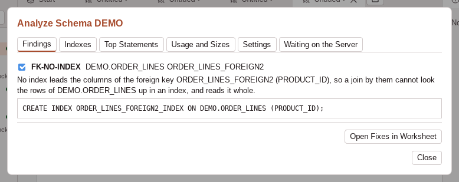
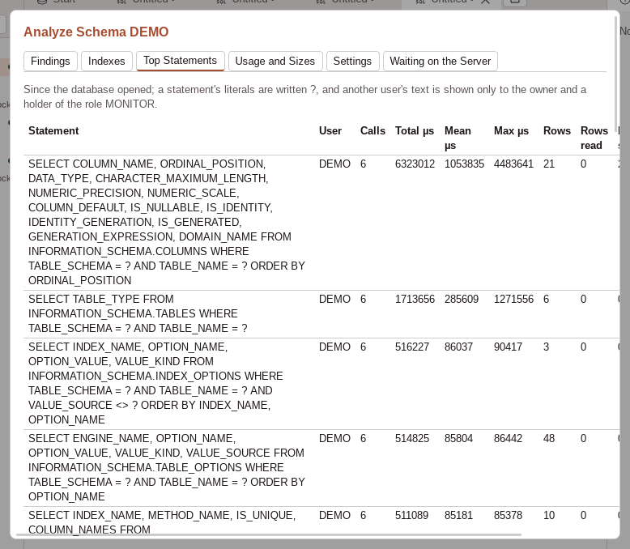
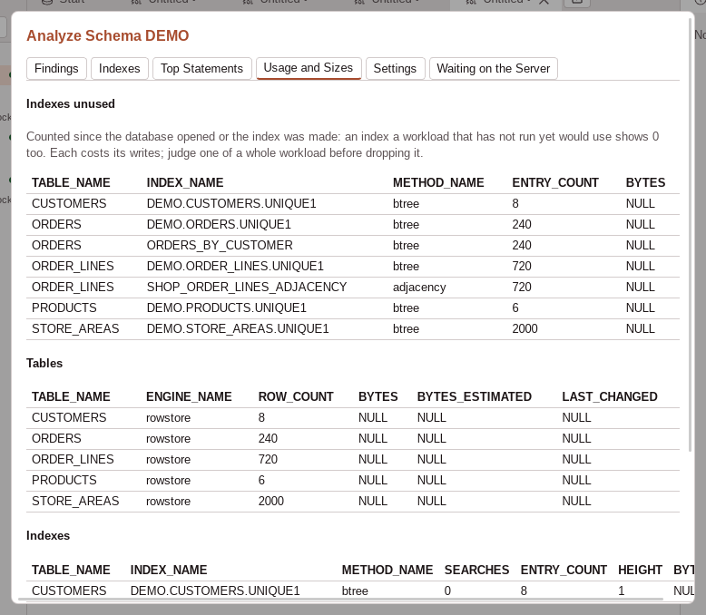
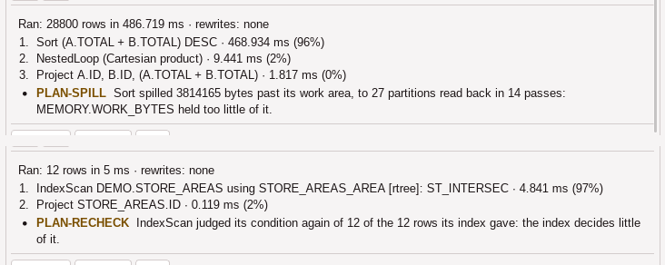
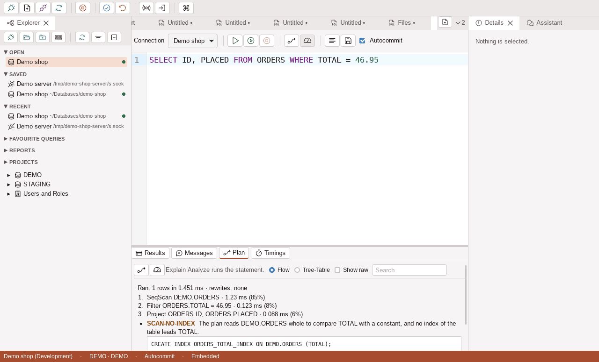
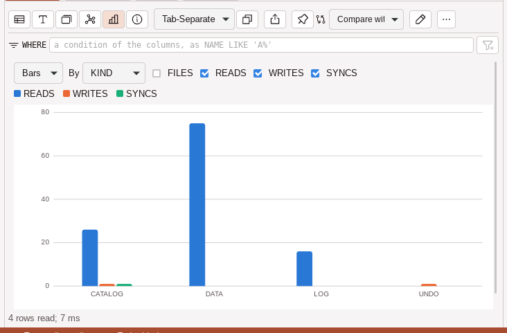

# The Analyzer

[Contents](README.md)

The analyzer reads a schema's tables and the database's settings, and
finds what to change: each finding names its rule, says what it found
and why it matters, and gives its fix as SQL, which opens in a worksheet
to be read and run there, never by the analyzer. Every rule is judged of
the catalog as read, so the same schema gives the same findings. The
plan of a statement is judged too, and an index it proposes is tried
first by a what-if. Reports show what the Information Schema holds, and
the user's own queries, as tables or charts.

## Analyzing a schema

**Connection > Analyze Schema…** analyzes the session's schema; a
schema's details, in the explorer, offer **Analyze Schema…** of it. The
analyzer reads each base table of the schema whole, and the database's
settings, and shows six tabs:

| Tab | What it shows |
|---|---|
| **Findings** | each finding: its rule, what it is of, what it says, and its fix |
| **Indexes** | each index of the schema: its table, name, method, whether it is unique, its columns, its options, and the PRIMARY KEY or UNIQUE constraint it was made for |
| **Settings** | each setting whose value is not its default: its value, its default, where the value comes from, and when a change takes effect |
| **Top Statements** | the 25 statements run since the database opened that took the most time in all ([Top statements](#top-statements)) |
| **Usage and Sizes** | of the schema, the indexes no search used, and each table's and index's size ([Usage and sizes](#usage-and-sizes)) |
| **Waiting on the Server** | what the analyzer cannot show yet, and why: the planner's statistics of a column |



[The same, in the dark theme](../images/analyzer-findings-dark.png).

Each finding is chosen at first; **Open Fixes in Worksheet** opens the
fixes of those chosen in a worksheet of the connection, a blank line
between each.

## Top statements

**Top Statements** reads the statements the database has run since it
opened, by their text, each literal written `?`, and their user
([Monitoring](https://github.com/turborel/turborel/blob/main/doc/operator/11-monitoring.md#statement-statistics)):
each one's calls, the microseconds of their work in all, on average and
at most, the rows it gave or changed, read and spilled. The costliest
in all come first. **Explain** of a query opens it in a worksheet as
`EXPLAIN`, where the plan viewer shows its plan; a statement written
with `?` asks for its values first. Another user's text is shown only
to the database's owner and a holder of the role MONITOR
([Administration](12-administration.md#who-sees-the-sessions-and-statements)).



[The same, in the dark theme](../images/analyzer-top-statements-dark.png).

## Usage and sizes

**Usage and Sizes** reads TABLE_STATISTICS and INDEX_STATISTICS of the
schema:

- **Indexes unused:** each index whose searches are 0. The count is of
  the time since the database opened, or the index was made, so an index
  a workload uses that has not run since shows 0 too: judge one of a
  whole workload before dropping it. Each costs its writes.
- **Tables:** each base table's engine, rows and bytes, whether some
  are estimated, and when it last changed.
- **Indexes:** each index's method, searches, entries, height and bytes.



[The same, in the dark theme](../images/analyzer-usage-dark.png).

A row store table's bytes are unknown until its statistics are first
gathered, which reading the view asks for.

## The rules

| Rule | What it finds | Its fix |
|---|---|---|
| `FK-NO-INDEX` | a foreign key whose columns no index leads: no `btree` index of them first, in any order, nor a `hash` index of them alone; a join by them cannot look the table's rows up in an index, and reads it whole | `CREATE INDEX` of the foreign key's columns, named for it, `_INDEX` after its name |
| `INDEX-DUPLICATE` | an index CREATE INDEX made of the method, columns, in order, and options of another, or of a constraint's index | `DROP INDEX` of it, the one made later |
| `INDEX-PREFIX` | an index whose columns lead, in order, those of another `btree` index; each write keeps both, and the longer may serve its lookups, which their plans tell | `DROP INDEX` of it |
| `TABLE-NO-KEY` | a base table of no primary key | of its first UNIQUE constraint whose columns are each NOT NULL, that constraint dropped and made again of its name as the primary key, as a table takes no two keys of the same columns; else a comment saying to name the key's columns |
| `SETTING-ADVISED` | a setting of a value the manual warns of ([Settings](https://github.com/turborel/turborel/blob/main/doc/appendix/c-settings.md)) | the setting given its default, by SET of a session's value, or SET DATABASE of the database's |
| `SCAN-NO-INDEX` | a table the plan reads whole to compare a column with a constant, where no index leads the column ([The plan's findings](#the-plans-findings)) | `CREATE INDEX` of the column |

The plan's own warnings, `PLAN-FULL-SCAN`, `PLAN-SERIAL`,
`PLAN-MISESTIMATE`, `PLAN-MANY-PROBES`, `PLAN-SPILL` and `PLAN-RECHECK`,
are told by the plan viewer
([Worksheets](05-worksheets.md#the-plan)); none has a fix of SQL. So are
its notes of what is well: `PLAN-SEMI-JOIN`, a subquery made a semi
join, and `PLAN-ANTIJOIN`, NOT EXISTS or NOT IN made an antijoin, NOT
IN keeping its meaning with nulls.

A constraint's index is never dropped by a fix. A partition is judged
with its partitioned table, not apart. `SETTING-ADVISED` finds:

| Setting | Of | What the manual says it does |
|---|---|---|
| LOG.COMMIT_SYNC | OFF | a commit returns before its record is synced to the log, and is lost if the system fails before the log is next synced |
| LOG.DURABILITY | NONE | the log is never synced, so a failure of the system may lose any commit |
| SERVER.SCRAM_WITHOUT_TLS | ON | SCRAM-SHA-256 is taken over plain TCP, where an eavesdropper may guess the password from the exchange |
| SERVER.TRUST_LOCAL | ON | a client of this machine is trusted as who it says, without proving it |

A setting the node's operator sets, not SQL, is fixed by a comment that
says so. A change of a setting taken at the next start, from the next
connection or from the next transaction says so in the finding.

Of the schema ANN, of a table STAFF of no primary key, a UNIQUE
constraint STAFF_ID of its column ID, NOT NULL, a foreign key
STAFF_DEPT of DEPT no index leads, two indexes of NAME, STAFF_NAME and
STAFF_NAME_AGAIN, and STAFF_NAME_AGE of NAME and AGE, the fixes are:

```sql
CREATE INDEX STAFF_DEPT_INDEX ON ANN.STAFF (DEPT);

DROP INDEX STAFF_NAME_AGAIN;

DROP INDEX STAFF_NAME;

ALTER TABLE ANN.STAFF DROP CONSTRAINT STAFF_ID RESTRICT;
ALTER TABLE ANN.STAFF ADD CONSTRAINT STAFF_ID PRIMARY KEY (ID);
```

## Waiting on the server

Turborel does not yet show some of what an analyzer would read, so the
analyzer shows each as unavailable, saying why:

- **Statement statistics:** the statements run, their calls, rows and
  times.
- **Table and index statistics:** a table's rows, sizes and scans; an
  index's size and use.
- **Column statistics:** the planner's statistics of a column, its
  distinct values and nulls.
- **Sizes of objects:** a table's or index's size on disk.

## The plan's findings

Among the warnings of the plan of a statement Explain or Explain Analyze
ran ([Worksheets](05-worksheets.md#the-plan)), the findings of
`SCAN-NO-INDEX` of its physical stage are listed: of each table the plan
reads whole under a filter comparing one of its columns with a constant,
by `=`, `<`, `>`, `<=`, `>=`, BETWEEN, IN or LIKE of a pattern that
begins with characters, where no index of the table leads the column.
**Open Fix in Worksheet** opens its CREATE INDEX in a worksheet; **What
If…** tries it first.



[The same, in the dark theme](../images/plan-warnings-dark.png).

## What if

A what-if makes the index, explains the statement again, and drops the
index, so the plan before and the plan with the index are compared side
by side. Turborel makes an index for real, of the table's rows, apart
from any transaction, and other sessions see it while it stands; so it
runs only when **Make, Explain and Drop** is chosen, after the dialog
says so. Each statement runs through the connection's guards. An index
statement runs outside a transaction, so the session must have none
open; not under autocommit, the transaction EXPLAIN begins is rolled
back before DROP INDEX. If the index cannot be made, nothing more runs.



[The same, in the dark theme](../images/plan-compare-dark.gif).

```sql
CREATE INDEX PARTS_NAME_INDEX ON ANN.PARTS (NAME);
EXPLAIN SELECT ID FROM ANN.PARTS WHERE NAME = 'part 7';
DROP INDEX PARTS_NAME_INDEX;
```

Before, the plan reads the table whole:

```
 Project PARTS.ID
   Filter PARTS.NAME = 'part 7'  (est. rows=10)
     SeqScan ANN.PARTS  (rows=1000, cost=1000.0)
```

with the index, it reads the index:

```
 Project PARTS.ID
   IndexScan ANN.PARTS using PARTS_NAME_INDEX [btree]: PARTS.NAME = 'part 7'  (est. rows=1, cost=20.6)
```

## Reports

The explorer's **Reports** lists the built-in reports, then the user's
own. A click opens a report in a worksheet of its own, on the active
connection, and runs it there, as any query runs: through the
connection's guards, its parameters' values asked
([Worksheets](05-worksheets.md#parameters-and-script-variables)). Its
rows are shown as a table, or in the chart view as its chart says.



[The same, in the dark theme](../images/report-chart-dark.png).

| Built-in report | What it shows |
|---|---|
| **Objects by Schema** | each schema's tables and views by their type, routines by theirs, sequence generators and indexes, counted |
| **Files** | the database's files by kind and class: how many, and their reads, writes and syncs; a bar chart of the reads, writes and syncs |
| **Indexes** | each index: its table, name, method, whether it is unique, and its columns |
| **Table Privileges** | each privilege on a table: who holds it, of which table, which, whether it may be granted on, and by whom |
| **Settings Changed** | each setting not of its default: its value, default and source, when a change takes effect, and whether one waits for a restart |
| **Sessions** | each connection the server serves: its user, where it came from, its state and application, the statement it runs, when it and its transaction began, and what it waits on, the lock and the session holding it |
| **Top Statements by Total Time** | each statement run since the database opened, by its text and user: its calls, total, mean and longest microseconds, rows given or changed, read and spilled, and its last run |
| **Table Sizes** | each base table's engine, rows and bytes, whether they are estimated, and when it last changed, the largest first |
| **Index Sizes** | each index's method, entries, height and bytes, the largest first |
| **Indexes Unused since the Database Opened** | each index no search used since the database opened or it was made, its entries and bytes |

A result's **Save as Report…**, of its toolbar's menu **⋯**, keeps its query as a report of the
user's, under a name: shown in the chart view as it is drawn, if the
chart view is shown, else as a table. **Forget** lets one go. The
user's reports are kept in `reports.json`
([Appendix D](../appendix/d-files.md#reportsjson)).

## Charts

A result's **Chart View**, offered where a column holds numbers, draws
its rows as bars, or as lines through the rows in order: each row named
by the column **By** chooses, the first not of numbers at first, and the
numbers of the columns ticked, at first every other column of numbers,
at most eight. Each column drawn has a colour of its own, in a fixed
order; a legend names them when there are two or more. The scale's
ticks are round numbers, written compactly, as `1.2K`. Each bar or point
says its row, column and value as the pointer rests on it. The first 200
rows read are drawn; the grid view shows every value.
