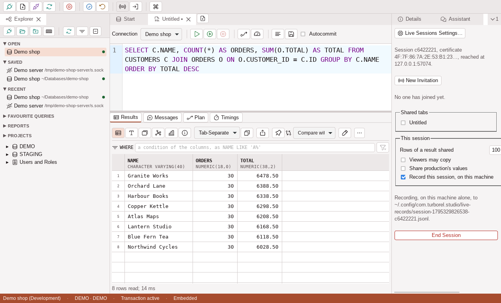
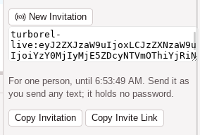
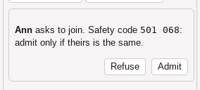
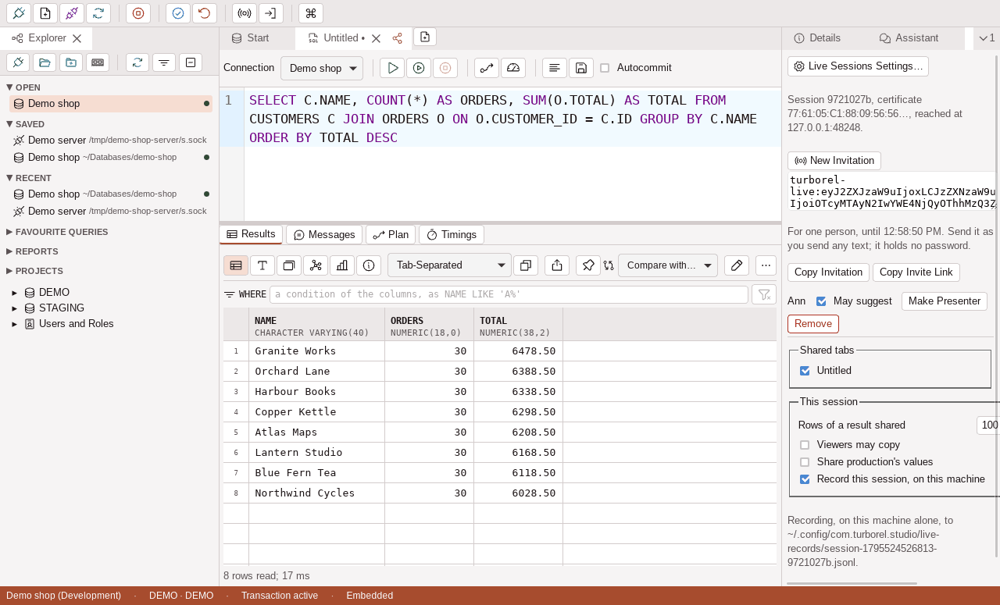
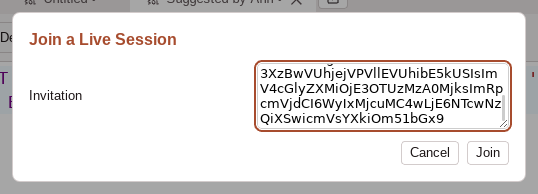
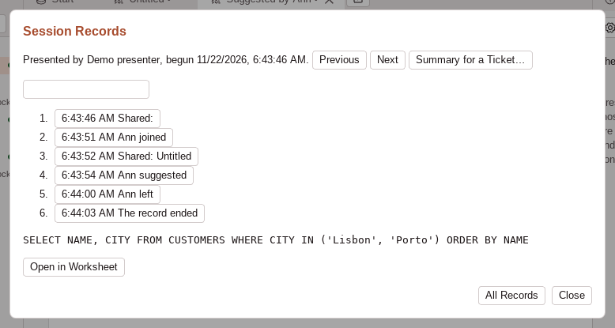
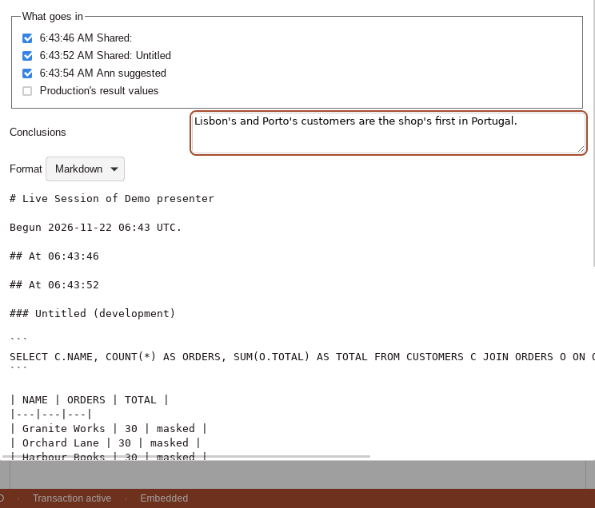
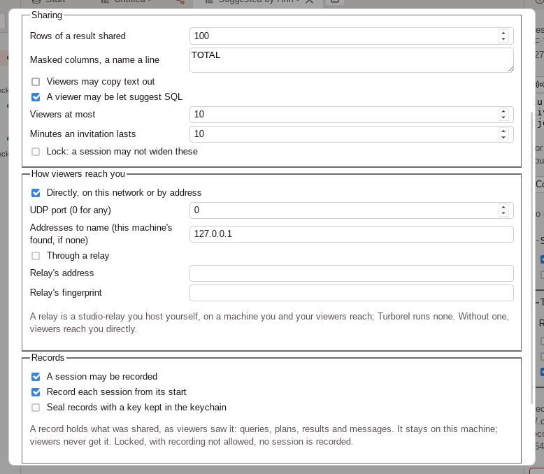

# Live Sessions

[Contents](README.md)

A Live Session shows your Studio to one or more people while you work,
to teach or to show, with nothing copied and pasted. **Present** shares
the tabs you pick: each viewer sees them live in their own Studio, drawn
as Studio draws them, and may follow you or look about alone. **Join**
watches a session you are invited to. Voice and video are left to
whatever call you already use.

What is shared is your workspace's state: your worksheets' SQL, your
selection in it, their results, messages and plans, a schema's diagram,
the analyzer's findings, and where you point. Your connections never
leave your Studio: a viewer has no session on the database, and can run
nothing on your connection. No password, key or connection setting is
ever sent. Everything is encrypted end to end, and you admit each
viewer yourself.

## Before the first session

Open **Live > Live Sessions Settings…** and give **Your name, as others
see it**: a presenter's and a viewer's name are each 1 to 64
characters. Sessions are on unless the settings turn them off
([The settings](#the-settings)).

## Presenting

**Present**, on the toolbar or in the **Live** menu, starts a session
and shows the **Live Session** panel, beside Details. The session can be
reached directly, by viewers on your network or who can reach your
address, and, where the settings name one, through a relay you host
([Relays](#relays)); Turborel runs none. The panel names the session, the start of its
certificate's fingerprint, and the addresses it is reached at.



[The same, in the dark theme](../images/live-session-dark.png).

### Inviting

**New Invitation** makes an invitation, a code that begins
`turborel-live:`. **Copy Invitation** copies it to send as you send any
text. It holds the session's identifier, the fingerprint of the
certificate made for this session, a secret, and the addresses that
reach you; no password. An invitation admits one person, once, and
expires after the minutes the settings give, 10 at first; make one for
each viewer.



[The same, in the dark theme](../images/live-invite-dark.png).

**Copy Invite Link** copies the same invitation as a link, which pastes
into any chat or ticket and opens Studio when clicked:

```
turborel-studio://join?code=eyJ2ZXJzaW9uIjoxLC...
```

The link holds the invitation and nothing else: it tells how to ask to
join, which the presenter must still admit, and no SQL, data, password
or setting. It expires with the invitation, and admits one person, once,
as the code does.

### Admitting

A viewer who joins by an invitation asks to be admitted: the panel
shows their name and a **safety code**, six digits drawn from the keys
of the encrypted channel between you. Their Studio shows the same code.
Compare the two, over your call, and **Admit** only if they are the
same; otherwise **Refuse**. A code that differs means someone stands
between you. A viewer not answered within 10 minutes is refused. At
most as many viewers as the settings allow, 10 at first, are admitted
or waiting at once.



[The same, in the dark theme](../images/live-admit-dark.png).

### What is shared

The panel's **Shared tabs** lists your worksheets and models: tick each
to share. A worksheet's tab's menu, and **Live > Share Worksheet in Live
Session**, share it too, and a shared tab is marked by an icon on its
tab. In the analyzer ([The Analyzer](09-analyzer.md)), **Share in Live
Session** shares its findings. Of each, viewers see:

| Tab | What is shared |
|---|---|
| A worksheet | its title, its SQL, your selection or cursor in it, the result it shows, its latest 50 messages, and its latest plan |
| A model | its diagram |
| The findings | each finding's rule, what it is of, and what it says |

The tab you show, and where your pointer is over a shared worksheet, go
too, so viewers may follow you. Studio sends what changed a few times a
second.

Before anything leaves, Studio filters it by the connection each
worksheet runs on, as the settings say for its environment:

- a connection of development or test shares its values: its result's
  rows, at most the session's limit, 100 at first;
- a connection of production shares its SQL, its result's columns and
  its plan, but no row and no message, unless the session shares
  production's values;
- an environment whose tabs the settings do not share leaves them out;
- a worksheet whose connection is closed is filtered as production's;
- a column named among the masked columns is sent of no value, and
  shown masked.

Rows past the limit are cut, and the viewer is told so. The whole of
what is shared is at most 8 MiB: share fewer tabs, or fewer rows.

### The session's choices

**This session**, in the panel, sets the rows of a result shared,
whether viewers may copy text out of what they see, and whether
production's values are shared. They begin as the settings give them.
Where the settings are locked, a session may narrow them but never
widen them.

### Hands, suggestions and the presenter's role

A viewer's raised hand shows beside their name. **May suggest** lets a
viewer suggest SQL, where the settings allow it: their suggestion
appears in your panel with their name, and **Open in Worksheet** opens
it in a new worksheet, **Suggested by** their name, on the connection
of the worksheet they suggested into. It never runs by itself: it runs
only when you run it, through the guards every statement runs through
([Worksheets](05-worksheets.md)). **Dismiss** lets it go.



[The same, in the dark theme](../images/live-suggestion-dark.gif).

**Make Presenter** hands your role to a viewer: their Studio shares the
tabs they pick, filtered by their own settings, and you and the others
see them in the panel. You still admit, remove and end. **Take Back**
returns the role to you.

**Remove** removes a viewer at once. **End Session** ends the session
for everyone.

## Joining

**Join…**, on the toolbar or in the **Live** menu, asks for the
invitation. Paste its code or its link and click **Join**.



[The same, in the dark theme](../images/live-join-dark.png).

Clicking an invitation's link opens Studio, starting it if it is not
running, at the same dialog, filled in. Above the invitation it shows
what the link holds: the session, the presenter's fingerprint, the
addresses and relay it is reached at, and until when. Nothing joins
until you click **Join**. A link of an invitation expired, of no
invitation, or that carries anything more than one, is refused, saying
why, and **Join** stays off until an invitation is pasted. Studio reaches the presenter
directly at each address the invitation names in turn, then through its
relay, and accepts only the certificate whose fingerprint the
invitation names. While you wait, the panel shows the safety code: read
it to the presenter.

Once admitted, the panel shows the workspace presented: its tabs, the
one the presenter shows chosen while **Follow the presenter** is ticked;
choose another to look about alone. A worksheet shows its SQL, the
presenter's selection marked, its result, its messages and its plan; a
model its diagram; the findings their list. A dot shows where the
presenter points. Unless the presenter allows copying, the text cannot
be selected, copied or cut.

**Raise Hand** raises your hand, and **Lower Hand** lowers it. Where
the presenter lets you suggest, a box under a worksheet sends SQL to
them, at most 64 KiB. **Leave** leaves the session.

What you are shown is held in memory alone: it is never saved, and is
let go as the session ends, as you leave, are removed, or the
presenter can no longer be reached.

## Records

A presenter may keep a record of a session, on this machine alone:
**Record this session, on this machine**, among the session's choices
in the panel, or **Record each session from its start** in the
settings. While it records, the panel says where. The record holds what
was shared and nothing more: each workspace as the viewers saw it, its
queries, plans, results and messages, the masked columns of no value and
the rows cut as the session's limit cut them, with when each was shared
and by whom; each suggestion, with who made it; and who came and went.
Where the presenter only points, nothing is kept. Viewers never get a
record; a summary reaches them only if the presenter sends it.



[The same, in the dark theme](../images/live-replay-dark.png).



[The same, in the dark theme](../images/live-summary-dark.png).

A record is a file of the user's alone, in the configuration's
`live-records` folder ([Files](../appendix/d-files.md#live-records)).
**Seal records with a key kept in the keychain** seals each entry under
a key Studio makes and keeps in the keychain, so the file holds no text
of what was shared; a sealed record is read only on a machine whose
keychain holds that key. A record unsealed holds the results' values as
they were shown: keep it as you keep them. **A session may be
recorded**, off with the settings locked, records no session.

**Live > Session Records…** lists the records kept, the latest first.
Opening one shows its timeline, each moment by its time: a workspace
shared, a suggestion, someone coming or going. **Previous** and **Next**
step through it, **Find in the record** keeps the moments whose SQL,
messages or plans hold a text, and the moment chosen is shown as the
viewers saw it, a tab at a time. **Open in Worksheet** opens a tab's SQL,
or a suggestion, in a worksheet; **Compare the plan with** shows a tab's
plan at this moment and another, line by line, the lines that differ
marked.

**Summary for a Ticket…** writes a summary of the moments picked, each
workspace shared and each suggestion at first: each worksheet's SQL,
the first 12 lines of its plan, its result, the first 20 rows, a masked
column written `masked`; the suggestions; and the conclusions written
under **Conclusions**. A production tab's result is written of its
columns alone unless **Production's result values** is ticked, which it
is not at first. **Format** chooses Markdown or HTML, the preview shows
exactly what is written, and **Save Summary…** saves it where the
platform's dialog chooses:

```
# Live Session of Ann

## At 09:02:00

### Dev (development)

| NAME | SALARY |
|---|---|
| Ada | masked |
```

## How it is kept safe

- **Encryption:** a session is carried by QUIC, its TLS 1.3 made with a
  certificate made for the session as it starts, whose key never leaves
  the presenter's memory. A viewer accepts that certificate alone, by
  the fingerprint the invitation carries.
- **Relays see nothing:** through a relay, the viewer and the presenter
  run a TLS 1.3 session of their own inside what the relay passes,
  pinned the same way, so the relay passes bytes it cannot read.
- **Approval:** each viewer is admitted by name, after the safety codes
  are compared; an invitation is used once and expires.
- **Nothing of a connection is shared:** no password, key, address,
  user or setting of a connection is sent; viewers run nothing.

## Relays

A viewer who cannot reach the presenter directly reaches them through a
relay, `studio-relay`, a small program of this repository that you host
yourself, on a machine both of you can reach. Turborel runs no relay of
its own: a session is reached directly, or through a relay you run. It
keeps no accounts, and holds its sessions in memory alone.

```
cargo build --release --bin studio-relay
target/release/studio-relay --listen 0.0.0.0:4433 --identity relay-identity
```

```
studio-relay: listening on 0.0.0.0:4433
studio-relay: fingerprint AC:46:D7:A5:18:67:8A:7B:C5:19:67:8C:F2:86:50:84:47:F1:3D:74:F1:78:8F:C5:94:AC:55:4C:FD:33:65:BE
```

| Option | What it does | At first |
|---|---|---|
| `--listen ADDRESS` | the UDP address it listens on | `0.0.0.0:4433` |
| `--identity DIRECTORY` | keeps its certificate in the directory, `relay.der` and `relay.key`, made the first time, so its fingerprint stays the same | a certificate made as it starts |
| `--sessions N` | the most sessions at once | 1000 |
| `--guests N` | the most viewers of a session at once | 64 |

In the settings, tick **Through a relay**, and give the relay's address,
`host:port`, and the fingerprint it prints. Invitations then name the
relay, and viewers reach you through it. No relay is set at first, and
Studio names none: the address is always that of a relay you host.

## The settings

**Live > Live Sessions Settings…** shows every setting on one page,
kept in `live-sessions.json`
([Files](../appendix/d-files.md#live-sessionsjson)):

| Setting | At first | Bounds |
|---|---|---|
| **Live Sessions are on** | on | |
| **Your name, as others see it** | none | 1 to 64 characters |
| **Development: share its tabs**, **and its values** | both | |
| **Test: share its tabs**, **and its values** | both | |
| **Production: share its tabs**, **and its values** | its tabs alone | |
| **Rows of a result shared** | 100 | 1 to 10,000 |
| **Masked columns, a name a line** | none | 500 |
| **Viewers may copy text out** | off | |
| **A viewer may be let suggest SQL** | on | |
| **Viewers at most** | 10 | 1 to 64 |
| **Minutes an invitation lasts** | 10 | 1 to 60 |
| **Lock: a session may not widen these** | off | |
| **Directly, on this network or by address** | on | |
| **UDP port (0 for any)** | 0 | |
| **Addresses to name** | this machine's address found, if none | 8 |
| **Through a relay**, **Relay's address**, **Relay's fingerprint** | off | |



[The same, in the dark theme](../images/live-settings-dark.png).

A session is reached directly, through a relay, or both.

## The log

Studio logs each session on this computer alone, in
`live-sessions-audit.jsonl`
([Files](../appendix/d-files.md#live-sessions-auditjsonl)): a session
started and ended, each invitation made, each viewer asking, admitted,
refused, leaving and removed, each Suggest granted and taken back, each
change of presenter and of the session's choices, and each suggestion
with its SQL; and, of a session joined, the joining, the suggestions
made, and the leaving, removal, refusal, end or loss. It holds no
workspace and no secret. The settings' **Show the Log** shows the
latest 1000; **Clear the Log** forgets them.
