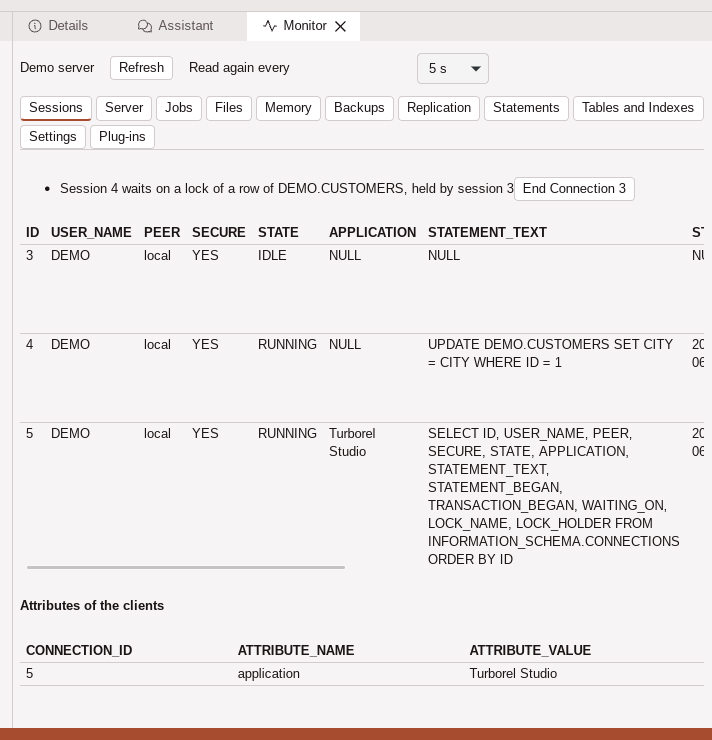
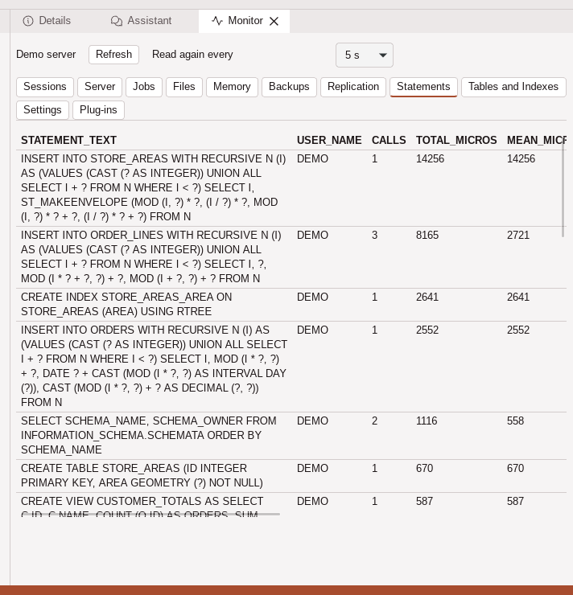
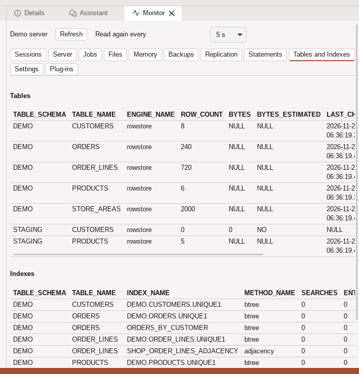
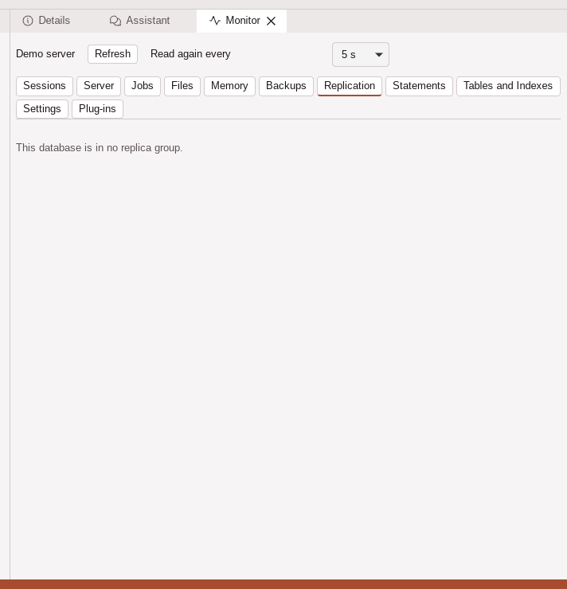
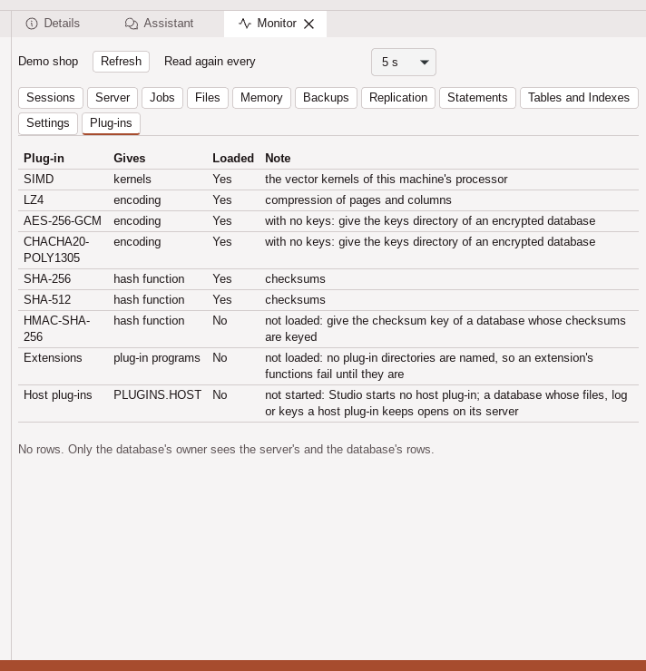
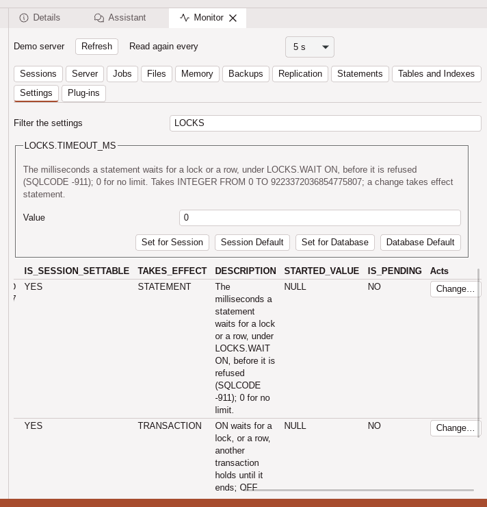
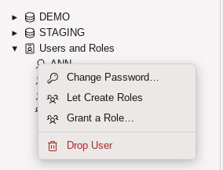
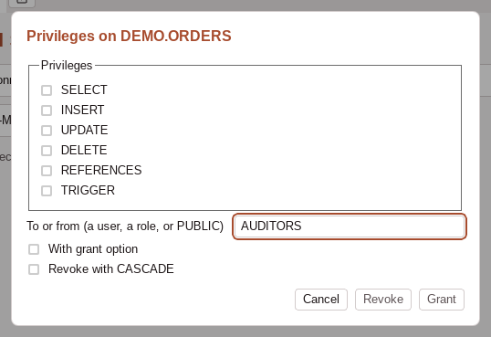

# Administration

[Contents](README.md)

Studio watches and changes the server of the active connection: its
sessions, its counters, its work, files and memory, its backups, its
replica group and its settings, in the **Monitor**; and its users,
roles and privileges, from the Object Explorer. Each change is a
statement Studio writes of what you choose, never typed, and runs
through the connection's guards, as any statement runs
([Connections](03-connections.md)): a statement that destroys asks
first, and a production connection asks before any write.

The server shows the rows of most of these views to the database's
owner alone; to another user, the monitor shows none, and says so
([The Information Schema](https://github.com/turborel/turborel/blob/main/doc/sql/07-information-schema.md)).
The sessions, the statements and the tables' and indexes' statistics it
shows as the next section says.

## Who sees the sessions and statements

Statement texts carry the values written in them, so the server narrows
who sees them
([Monitoring](https://github.com/turborel/turborel/blob/main/doc/operator/11-monitoring.md)).
The database's owner sees every session, statement and table. So does a
user granted the role MONITOR, if the owner made that role:

```sql
CREATE ROLE MONITOR;
GRANT MONITOR TO BOB;
```

**Users and Roles > New Role…** makes it, and **Grant a Role…** grants
it ([Users, roles and privileges](#users-roles-and-privileges)); REVOKE
MONITOR FROM BOB takes it back. A role named MONITOR that another user
made gives nothing. Any other user sees their own sessions, every
statement with other users' texts empty, and the tables they hold a
privilege on, with those tables' indexes.

## The monitor

**Connection > Monitor** shows the **Monitor** panel, of the active
connection. **Refresh** reads its views again, and **Read again every**
reads them each 1, 2, 5, 10 or 30 seconds, 5 at first, or never.



[The same, in the dark theme](../images/monitor-sessions-dark.png).



[The same, in the dark theme](../images/monitor-statements-dark.png).



[The same, in the dark theme](../images/monitor-tables-dark.png).



[The same, in the dark theme](../images/monitor-replication-dark.png).



[The same, in the dark theme](../images/monitor-plugins-dark.png).

| Tab | What it shows | Of the view |
|---|---|---|
| **Sessions** | each connection the server serves: its ID, user, where it came from, whether it is secure, its state (LOGIN, IDLE or RUNNING), its application, the statement it runs and when it began, when its transaction began, and what it waits on, the lock and the session holding it; above them, each session that waits, in a line; and the attributes each client gave | CONNECTIONS, CONNECTION_ATTRIBUTES |
| **Statements** | each statement run since the database opened, by its text, its literals written `?`, and its user, the costliest by total time first: its calls, its total, mean and longest time in microseconds, the rows it gave or changed, read and spilled, and when it last ran | STATEMENT_STATISTICS |
| **Tables and Indexes** | each base table's engine, rows, bytes, whether they are estimated, and when it last changed and was compacted; each index's method, searches and the entries they read since the database opened, its entries, height and bytes | TABLE_STATISTICS, INDEX_STATISTICS |
| **Server** | the workers running a statement, the statements waiting for one, the connections, those refused and closed untold, and the transactions committed and rolled back; drawn over the time the panel is open | SERVER |
| **Jobs** | each job of the database's background work: its state, whether a thread of its own runs it, its runs, restarts and last error | JOBS |
| **Files** | each file of the database: its kind, class of durability, whether it is open, its reads, writes and syncs; and whether each kind of file is in the formats the settings name | FILES, FILE_FORMATS |
| **Memory** | each part of the memory budget reserved | MEMORY_RESERVATIONS |
| **Backups** | the backups, the restore points and the log's segments archived | BACKUPS, RESTORE_POINTS, ARCHIVED_SEGMENTS |
| **Replication** | each member of the database's replica group: its address, role, epoch and view, and whether this node's link to it is up; of a database in no replica group, that it is in none | REPLICAS |
| **Settings** | each setting, its value as the session sees it, where the value comes from, its default and kind, whether a session may set it, and when a change takes effect | SETTINGS |
| **Plug-ins** | of an embedded database, each plug-in Studio gave it, whether it is loaded, and why not ([Connections](03-connections.md#settings-and-plug-ins)); then each extension created, its version, directory and signer, and its plug-in's processes and calls since the database opened | EXTENSIONS |

An embedded database has no server, so no **Sessions** nor **Server**
views: the monitor says so in those tabs, and shows the rest.

The **Server** tab draws the workers busy, the statements waiting and
the connections, read by read, the last 120 readings, once read twice.

A session that waits on another's lock is told above the sessions,
"Session 7 waits on a lock of ANN.T, held by session 8", with **End
Connection 8**, which ends the session that holds it, asked about first
as every End Connection is. STATEMENTS.KEPT bounds the statements kept,
1000 unless set otherwise; setting it to 0 in **Settings** forgets them
all.

### Ending and cancelling a session

In **Sessions**, **Cancel Statement** cancels the statement a running
session runs, and **End Connection** ends the session; ending one is
marked as an act that destroys. Studio writes:

```sql
CANCEL CONNECTION 7;
END CONNECTION 7;
```

([CANCEL CONNECTION](https://github.com/turborel/turborel/blob/main/doc/sql/statements/cancel-connection.md),
[END CONNECTION](https://github.com/turborel/turborel/blob/main/doc/sql/statements/end-connection.md))

### Settings

In **Settings**, **Filter the settings** finds settings by name, and
**Change…** opens a setting: its description, its kind, and when a
change takes effect. Give the **Value**, written as the view writes
values, and choose:

| Button | Studio writes | |
|---|---|---|
| **Set for Session** | `SET STATEMENT.TIMEOUT_MS = 5000` | the session's own value, where a session may set it |
| **Session Default** | `SET STATEMENT.TIMEOUT_MS = DEFAULT` | the database's value again |
| **Set for Database** | `SET DATABASE LOCKS.WAIT = 'ON'` | the database's value, the owner's to set |
| **Database Default** | `SET DATABASE LOCKS.WAIT = DEFAULT` | the built-in default again |



[The same, in the dark theme](../images/monitor-settings-dark.png).

A setting of an integer's kind is written as a whole number, any other
as a quoted literal. A setting taken at the next start shows its value
waiting until then
([SET](https://github.com/turborel/turborel/blob/main/doc/sql/statements/set-setting.md),
[SET DATABASE](https://github.com/turborel/turborel/blob/main/doc/sql/statements/set-database.md)).

## Users, roles and privileges

The Object Explorer's **Users and Roles** ([The Object
Explorer](04-explorer.md)) holds the users and the roles granted. Their
menus act on them:

| Of | Item | Studio writes |
|---|---|---|
| **Users and Roles** | **New User…** | `CREATE USER BOB PASSWORD '…'` |
| | **New Role…** | `CREATE ROLE AUDITORS` |
| A user | **Change Password…** | `ALTER USER BOB PASSWORD '…'` |
| | **Let Create Roles**, or **Forbid Creating Roles** | `ALTER USER BOB CREATE ROLE`, or `NO CREATE ROLE` |
| | **Grant a Role…** | the dialog of a role, of the user |
| | **Drop User** | `DROP USER BOB` |
| A role | **Grant or Revoke…** | `GRANT AUDITORS TO BOB`, or `REVOKE AUDITORS FROM BOB RESTRICT` |
| | **Drop Role** | `DROP ROLE AUDITORS RESTRICT` |
| A table or view | **Privileges…** | `GRANT SELECT, INSERT ON TABLE ANN.STAFF TO BOB`, or `REVOKE … FROM BOB RESTRICT` |



[The same, in the dark theme](../images/users-roles-dark.png).



[The same, in the dark theme](../images/privileges-dark.png).

A new user's password is given twice, and must be the same. It is sent
once to the server, and kept in no file, history or log. A name is
written as SQL writes it: an identifier is folded to upper case, as
`bob` is BOB, and a delimited one, `"bob"`, kept as written. The role's
dialog grants **With admin option**, and revokes **With CASCADE**; the
privileges' dialog grants SELECT, INSERT, UPDATE, DELETE, REFERENCES and
TRIGGER, **With grant option**, to a user, a role or PUBLIC. **Drop
User** and **Drop Role** are marked in the menus as acts that destroy;
DROP USER asks first, as the guards ask of a statement that destroys,
and on a production connection each act asks first. After each, the explorer reads the users and roles again
([GRANT](https://github.com/turborel/turborel/blob/main/doc/sql/statements/grant.md),
[REVOKE](https://github.com/turborel/turborel/blob/main/doc/sql/statements/revoke.md),
[CREATE USER](https://github.com/turborel/turborel/blob/main/doc/sql/statements/create-user.md)).
